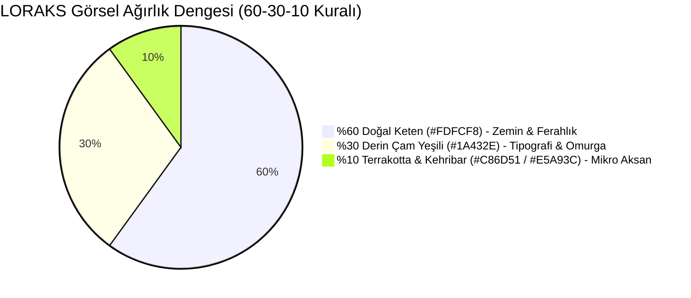

# LORAKS: NİHAİ MARKA KİMLİĞİ, GÖRSEL ESTETİK VE TASARIM RAPORU
**"Amatör Samimiyetten Küresel TravelTech Zarafetine: Editoryal Modern Anadolu Ev Sahipliği"**

* **Sürüm:** `v1.0 (Final Master Branding & Art Direction)`
* **Tarih:** 06 Ekim 2026
* **Kapsam:** Drive klasöründeki ilk görsel/branding çalışmaları, Gemini görsel kitaplığı denemeleri, orijinal logo konsepti, Lovable UI dönüşüm parametreleri ve Google AI Studio görsel üretim talimatları.
* **Marka:** LORAKS (LORAKS TEKNOLOJİ A.Ş. & LORAKS SEYAHAT ACENTASI A.Ş.)

---

## 1. MARKA RUHU VE ÇIKIŞ NOKTASININ DÖNÜŞÜMÜ (BLEND & MERGE)

### 1.1 İlk Çalışmalardaki Amatör Ruhun Değeri
Drive ve ilk taslaklarda ortaya koyduğunuz çalışmaların merkezinde çok kıymetli bir **"öz"** vardı:
* Mahalle sofralarının sıcaklığı,
* Düğüne müzisyen, mevlide lokma, bağ bozumuna neşe katan Anadolu insanının içtenliği,
* Samimi, kucaklayıcı ve yaşayan buluşmalar.

### 1.2 Yapılan Kritik Dengeleme (The Refinement)
* **Önceki Sorun (Aşırı Sıcaklık & Yoğunluk):** İlk taslaklarda kullanılan yoğun kiremit kırmızısı, çiğ turuncular ve kalabalık etiketler, siteyi modern bir TravelTech platformu yerine *"yerel bir broşür"* veya *"indirimli bilet sitesi"* gibi gösteriyordu.
* **Yeni Denge (Sıcaklığı Terbiye Etmek):** Anadolu misafirperverliğinin samimiyetini silmedik; onu **Kinfolk / Cereal seyahat dergisi zarafetinde, editoryal, dingin ve nefes alan** bir pazar yeri standardına taşıdık.

```
┌────────────────────────────────────────────────────────────────────────┐
│                   LORAKS ESTETİK DÖNÜŞÜM ÇARKISI                       │
├──────────────────────────────────┬─────────────────────────────────────┤
│ 🏺 İLK AMATÖR ENERJİ (KORUNAN ÖZ)│ ✨ EDİTORYAL TRAVELTECH (YENİ FORM) │
├──────────────────────────────────┼─────────────────────────────────────┤
│ • Sofranın bereketi              │ • Doğal Keten zemin (#FDFCF8)       │
│ • Zanaatkarın çamurlu elleri     │ • Derin Çam Yeşili tipografi        │
│ • "Bizden" olma samimiyeti       │ • Cömert negatif alan (White space) │
│ • İnsan odaklı hikayeler         │ • TÜRSAB & Zorunlu Sigorta zarafeti │
└──────────────────────────────────┴─────────────────────────────────────┘
```

---

## 2. LORAKS LOGOSU: GEOMETRİ, TİPOGRAFİ VE KULLANIM KURALLARI

Gemini ve Drive taslaklarında çalıştığınız logo kimliği, soğuk bir teknoloji ikonu değil; **köklü güveni ve yaşayan kültürü** simgeler.

### 2.1 Logo Tipografisi ve Karakteri
* **Yazı Karakteri (Wordmark):** Karakterli, oturaklı, modern editoryal bir Serif tabanı üzerine inşa edilmiştir (High-contrast Serif).
* **Harf Oranları:** `L - O - R - A - K - S` harfleri geniş aralıklı (tracking: `+0.08em` veya `+1.5px`), nefes alan, dik ve asil bir duruşa sahiptir.
* **Anlam Katmanı:**
  * **O Harfi:** Sofrayı, bir araya gelmeyi, yaşam döngüsünü ve kapalı devre güveni (Circle) temsil eder.
  * **K ve S Bitişi:** İleriye ve geleceğe uzanan teknolojik zarafet.

### 2.2 Renk Varyasyonları ve Güvenli Alan

```
Varyasyon 1: Açık Zemin (Birincil - Web/Mobil Header)
Zemin:  #FDFCF8 (Doğal Keten)
Logo:   #1A432E (Derin Çam Yeşili)
Tagline: "Kendine Zaman Tanı" (Derin Çam Yeşili %70 Opaklık)

Varyasyon 2: Koyu Zemin (Editoryal Hero / Footer / Broşür)
Zemin:  #1A432E (Derin Çam Yeşili)
Logo:   #FDFCF8 (Doğal Keten) veya #E5A93C (Kehribar Vurgu)

Varyasyon 3: Muvazaa Önleyici Sosyal Medya Filigranı
Zemin:  Görsel üzeri yarı saydam cam (Backdrop Blur %80)
Logo:   #1A432E + TÜRSAB DDS QR Kodu
```

* **Minimum Boyut:** Dijital ekranda yükseklik minimum `28px`; baskılı materyalde `12mm`.
* **Güvenli Alan (Clear Space):** Logomark etrafında en az `O` harfinin yüksekliği kadar boşluk bırakılmalı, hiçbir metin veya buton bu sınıra girmemelidir.

---

## 3. NİHAİ RENK PALETİ: "60 - 30 - 10 KURALI"

Renk paleti doğrudan Anadolu’nun toprağından, zeytin ağaçlarından ve zanaat atölyelerinden damıtılmıştır:



### Renk Belirteçleri (Design Tokens)

| Token Adı | HEX Kodu | RGB | Rolü ve Kullanım Alanı |
|---|---|---|---|
| **Linen Canvas** | `#FDFCF8` | `253, 252, 248` | **%60 Dominant:** Web/mobil tüm ekran arka planı. Steril beyazın soğukluğunu kırar, gözü yormaz. |
| **Pine Primary** | `#1A432E` | `26, 67, 46` | **%30 Omurga:** Logomuz, başlıklar, ana arama/rezervasyon butonları, TÜRSAB DDS mühürleri. |
| **Sage Accent** | `#8FAF8C` | `143, 175, 140` | **Hafif Vurgu:** İnce ayırıcı çizgiler (borders), onay ikonları, wellness/doğa etiketleri. |
| **Terracotta Craft**| `#C86D51` | `200, 109, 81` | **%5 Mikro Aksan:** Zanaatkar atölye rozetleri, "LORAKS Sofra" kategori vurguları. |
| **Sunset Amber** | `#E5A93C` | `229, 169, 60` | **%5 Sıcak Işık:** Değerlendirme yıldızları (4.9 ★), Founding Host altın madalyonu. |
| **Charcoal Ink** | `#2C2A29` | `44, 42, 41` | **Tipografi Metni:** Gövde paragrafları, açıklamalar, seyahat şartları. |

---

## 4. TİPOGRAFİ HİYERARŞİSİ

1. **Başlıklar (Display & H1-H3):**
   * **Font:** `Playfair Display` (veya `Newsreader` / `Fraunces`)
   * **Stil:** Semi-Bold & Italic vurgular
   * **Örnek:** *"Özenle seçilmiş sofralar, zanaat ve yaşayan buluşmalar."*
2. **Arayüz ve Gövde (Body & UI):**
   * **Font:** `Plus Jakarta Sans` (veya `Inter`)
   * **Stil:** Regular (400), Medium (500), Semi-Bold (600)
   * **Örnek:** Fiyat gösterimleri, açıklamalar, buton yazıları.
3. **Mevzuat & Kod Bilgisi (Monospace):**
   * **Font:** `JetBrains Mono`
   * **Kullanım:** TÜRSAB Belge No (`TÜRSAB-XXXXX`), P0-P4 Pathway kodları, e-arşiv fatura ID'leri.

---

## 5. BİLEŞEN BAZINDA UYGULAMA REHBERİ (LOVABLE ENTEGRASYONU)

### 5.1 Hero Arama Kapsülü (Floating Search Capsule)
* **Zemin:** `rgba(255, 255, 255, 0.85)` + `backdrop-blur(12px)`.
* **Çerçeve:** `1px solid rgba(26, 67, 46, 0.08)`.
* **Gölge:** `box-shadow: 0 20px 40px -15px rgba(26, 67, 46, 0.06)`.
* **Buton:** `#1A432E` dolgulu, beyaz metinli, sağa yaslı oval buton.

### 5.2 Deneyim Kartı (Experience Card)
* **Fotoğraf Oranı:** `4:3` editoryal yatay oran.
* **Kart Köşeleri:** `rounded-2xl` (`16px`).
* **Etiket:** Sol üstte tekil, minik kapsül: `#FDFCF8` zemin üzerinde `#1A432E` metin (*"Urla · Şef Sofrası"*).
* **Fiyat Vurgusu:** `"2.000 TL / kişi"` — net, kalın, indirim bağırtısı olmadan asil duruş.

### 5.3 Muvazaa Önleyici Sosyal Medya Şablonu (Transkript 2 Entegrasyonu)
* **Ölçüler:** `1080x1920` (9:16 Instagram Story) ve `1080x1080` (1:1 Post).
* **Alt Bant (Footer Bar):** `#1A432E` zemin üzerinde beyaz tipografi:
  * Sol: **TÜRSAB DDS Doğrulama Karekodu**
  * Orta: *"Bu deneyim LORAKS Seyahat Acentası A.Ş. güvencesiyle düzenlenmektedir."*
  * Sağ: *"Rezervasyon: loraks.com/@hostadi"*

---

## 6. GOOGLE AI STUDIO / IMAGEN 3 GÖRSEL ÜRETİM REHBERİ

Google AI Studio'da (veya Gemini üzerinde) platformun amiral gemisi görsellerini üretirken **kesinlikle kullanacağınız birebir prompt kalıpları**:

### Prompt 1: Hero Görseli — Anadolu Zeytin & Şef Sofrası
```text
An authentic, high-end editorial travel magazine photograph of an intimate communal dinner table in an ancient olive grove in Urla, Aegean Turkey. Golden hour warm sunset light filtering through olive branches. A long rustic wooden table set with raw natural linen tablecloth (#FDFCF8), handmade ceramic plates, local Aegean mezze dishes, sourdough bread, and wildflowers. Elegant candid guests laughing in background, soft bokeh. 35mm film photography style, Kinfolk aesthetic, natural textures, quiet luxury, peaceful atmosphere. No stock photo look, no artificial smiles, ultra-realistic, 8k resolution.
```

### Prompt 2: Zanaat & Çömlek Atölyesi (Avanos / Kapadokya)
```text
A documentary-style editorial photograph of a master ceramic artisan's hands gently shaping raw terracotta clay on a traditional potter's wheel in Cappadocia. Natural morning daylight streaming through a stone arch window. Background reveals drying clay pots, rustic wooden shelves, natural dust motes in the sunbeam. Deep earthy terracotta (#C86D51), deep pine green pottery tools, and warm limestone surroundings. Focused, peaceful, artisanal craft mastery, shallow depth of field, Leica M11 photography aesthetic.
```

### Prompt 3: Tekne Yoga & Deniz İnzivası (Göcek / Datça)
```text
An aerial-angle editorial photograph of a wooden Turkish gulet anchored in a secluded turquoise cove in Datça during sunrise. On the teak wooden deck, four people are in peaceful yoga meditation postures on sage green linen mats (#8FAF8C). Crystal clear calm water showing submerged rocks, gentle golden morning mist over pine-covered hills. Serene, restorative, unhurried lifestyle, architectural symmetry, shot on Hasselblad, natural lighting.
```

### Prompt 4: Bağ Bozumu ve Tadım Buluşması (Bozcaada)
```text
Candid editorial photography of a boutique grape harvest gathering in Bozcaada vineyard at late afternoon. Wooden crates filled with ripe purple and golden grapes, glasses of artisanal juice, guests sitting on low stone benches under a fig tree. Warm amber sunset glow (#E5A93C), relaxed conversations, authentic Turkish island atmosphere, authentic, tactile, timeless.
```

---

## 7. LOVABLE İÇİN DOĞRUDAN UYGULANABİLİR TAILWIND TEMA KODU

Lovable projenizdeki `tailwind.config.ts` dosyasına yapıştırılacak renk konfigürasyonu:

```typescript
// tailwind.config.ts
export default {
  theme: {
    extend: {
      colors: {
        loraks: {
          linen: '#FDFCF8',      // Ana Canvas Arka Plan (%60)
          pine: '#1A432E',       // Kurumsal Omurga, Buton & Logo (%30)
          sage: '#8FAF8C',       // Dinginlik & Border Vurgusu
          terracotta: '#C86D51', // Zanaat & Sofra Rozetleri (%5)
          amber: '#E5A93C',      // Yıldız & Founding Host Rozeti (%5)
          charcoal: '#2C2A29',   // Gövde Tipografisi
        }
      },
      fontFamily: {
        serif: ['Playfair Display', 'Newsreader', 'serif'],
        sans: ['Plus Jakarta Sans', 'Inter', 'sans-serif'],
        mono: ['JetBrains Mono', 'monospace'],
      }
    }
  }
}
```

---
*İşbu Rapor, LORAKS'ın web sitesi ve mobil arayüz geliştirme sürecinde tek görsel kılavuzdur.*
