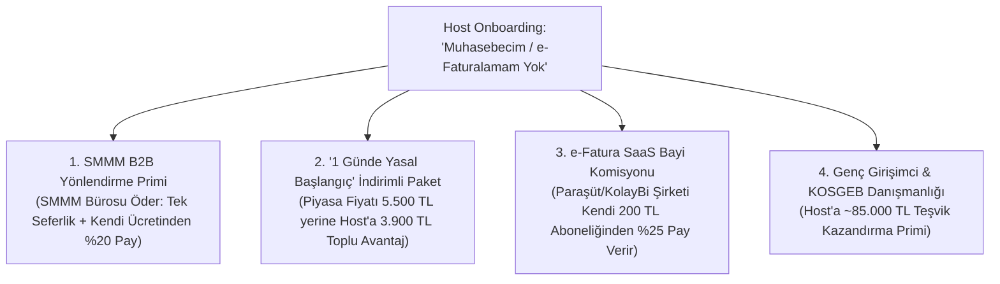

# LORAKS Host OS: B2B FinTech ve Danışmanlık Yan Gelirleri Modeli (Ancillary Revenue Engine)

---

## 1. Giriş ve Stratejik Fırsat
Deneyim pazaryerine kayıt olan bağımsız seramik sanatçıları, yoga eğitmenleri, ev şefleri, dağ rehberleri ve yerel zanaatkarların **%75–%80'inin** kurumsal bir şirketi, düzenli bir mali müşaviri veya e-fatura altyapısı bulunmamaktadır.

Bu üreticiler bürokrasiden, vergi dairesinden ve ceza almaktan çekinirler. LORAKS, kayıt (onboarding) sihirbazına eklediği **tek bir soruyla** bu bürokratik engeli şirketin en kârlı ve tekrarlayan (MRR) gelir kalemine dönüştürür:

```
┌────────────────────────────────────────────────────────────────────────┐
│               LORAKS HOST ONBOARDING — MALİ DANIŞMANLIK                │
├────────────────────────────────────────────────────────────────────────┤
│ ❓ Düzenli çalıştığınız bir mali müşaviriniz veya e-fatura            │
│    sisteminiz var mı?                                                 │
│                                                                        │
│   [ ] Evet, şirketim ve muhasebecim var                                │
│   [x] Hayır, desteğe ve rehberliğe ihtiyacım var                       │
└────────────────────────────────────────────────────────────────────────┘
```

---

## 2. Dört Temel Yan Gelir Akışı (4 Revenue Streams)

> [!IMPORTANT]
> **Host Gelirinin Kutsallığı İlkesi (Host Hak Edişi Asla Kesilmez):**  
> Host'un deneyim bilet gelirinden **kesinlikle ilave bir %25 veya gizli komisyon kesilmez.** Host bilet satışında sadece standart %15 platform hizmet payı ve kanuni %1 stopajı verir, net ~%84'ünü (2.000 TL bilette 1.683,33 TL) eksiksiz hesabına alır.  
> Aşağıda açıklanan %20–%25 oranları, **üçüncü taraf SaaS yazılımlarının (Paraşüt, KolayBi vb.) ve SMMM ofislerinin kendi normal ücret tarifelerinden LORAKS'a ödediği B2B iş ortaklığı / yönlendirme (Affiliate / Rev-Share) primidir.** Host'un cebinden standart piyasa fiyatı dışında 1 kuruş fazla para çıkmaz!



### 1. SMMM Yönlendirme Komisyonu (SMMM Tarafından Ödenen B2B Prim)
*   **İş Modeli:** LORAKS; İstanbul, İzmir, Muğla, Antalya gibi merkezlerde güvenilir, dijital odaklı SMMM ofisleriyle kurumsal iş ortaklığı protokolü imzalar.
*   **Gelir Modeli:**
    *   **Tek Seferlik Yönlendirme Primi (Lead Fee):** Her onaylı yeni mükellef için mali müşavirlik ofisi LORAKS'a **1.500 TL – 3.000 TL** yönlendirme bedeli öder.
    *   **Aylık Düzenli Gelir (Recurring Rev-Share):** Mali müşavirin host'a kestiği aylık standart defter tutma bedelinden (host'a hiçbir ek ücret bindirilmeden), SMMM ofisi kendi kazancının **%15 – %20'sini** LORAKS'a iş ortaklığı payı olarak aktarır.
    *   *1.000 aktif host'a ulaşıldığında bu kalem, sıfır operasyonel maliyetle aylık 200.000+ TL pasif B2B nakit akışı sağlar.*

### 2. "LORAKS 1 Günde Yasal Başlangıç Paketi" (Host'a Toplu Tasarruf Avantajı)
*   **İçerik:**
    1. İnteraktif Vergi Dairesi üzerinden online şahıs şirketi açılışı (veya GVK Md. 9 Esnaf Muafiyeti başvurusu).
    2. Mobil e-İmza temini.
    3. E-Fatura portalı aktivasyonu ve LORAKS API entegrasyonu.
*   **Fiyatlandırma:** Bağımsız bir üretici dışarıda tek başına koşturduğunda en az 5.500 TL harcar. LORAKS toplu anlaşma gücüyle host’a **3.900 TL indirimli paket** sağlar. Host hem 1.600 TL tasarruf eder hem yorulmaz; işlem başına **1.500 TL net kâr** LORAKS kasasında kalır.

### 3. E-Fatura SaaS Bayilik Payı (Paraşüt / KolayBi Tarafından Ödenen Rev-Share)
*   **Partnerler:** Paraşüt, KolayBi, BizimHesap veya Logo İşbaşı.
*   **Entegrasyon:** LORAKS'ta satılan her bilet, QR check-in yapıldığında host'un ön muhasebe paneline otomatik "Gelir Faturası Taslağı" olarak düşer.
*   **Gelir Akışı (Host'tan Kesilmez, Yazılım Şirketi Öder!):**
    *   Host kendi isteğiyle ayda ~200 TL'ye e-fatura SaaS yazılımı alır.
    *   Yazılım şirketi (Paraşüt/KolayBi), LORAKS bu müşteriyi getirdiği için her ay bu 200 TL'nin **%25'ini (50 TL)** LORAKS'a B2B kanal komisyonu olarak devreder.
    *   Host'un deneyim bilet gelirine veya cebine kesinlikle dokunulmaz.

### 4. Genç Girişimci & KOSGEB Danışmanlığı
*   29 yaş altındaki yüzlerce genç eğitmen ve sanatçının yararlanabileceği devasa devlet teşvikleri:
    *   **1 Yıl Boyunca Aylık Bağ-Kur Primini Devlet Öder** (Host'a Yıllık ~85.000 TL net nakit tasarrufu).
    *   **3 Vergilendirme Dönemi Boyunca Yıllık Belirli Tutara Kadar Sıfır Gelir Vergisi.**
*   LORAKS Danışmanlık birimi, bu teşvik başvurusunu başarıyla sonuçlandırdığında host'a kazandırdığı 85.000 TL tasarrufun karşılığı olarak tek seferlik cüzi bir **"Başarı Bazlı Teşvik Danışmanlık Bedeli"** tahsil eder. Host devasa tasarruf sağlar, LORAKS yüksek marjlı danışmanlık geliri elde eder.

---

## 3. Şirket Resmi Ana Sözleşmesi ile %100 Hukuki Uyum

Türkiye Ticaret Sicili Gazetesi (Sayı: 11599, Sayfa 1393) tescilli ana sözleşmemiz:
> **Madde 3/5:** *"Yönetim danışmanlığı, **iş planı hazırlama danışmanlığı, eğitim danışmanlığı, hibe ve fon danışmanlığı** yapmak..."*

Şirketimiz bu danışmanlık ve iş geliştirme hizmetlerini faturalandırmak üzere kanunen tescil edilmiş durumdadır.

---

## 4. Platforma Sağladığı Stratejik Üstünlük (Moat & Retention)

1. **Platformdan Kaçışı (Disintermediation / Leakage) Sıfırlar:**  
   Maliyesini, faturasını ve şirketini LORAKS'ın kurduğu ve yürüttüğü bir host, platformdan asla ayrılamaz. LORAKS onun sadece bilet sattığı yer değil, **işletim sistemi (Host OS)** haline gelir.
2. **Yatırımcı Gözünde Değer Sıçraması:**  
   Yatırımcılar LORAKS'ı yalnızca tek seferlik bilet komisyonu alan bir acente olarak değil; **FinTech + B2B SaaS + Müşavirlik Platformu** olarak değerlendirir. LTV (Müşteri Yaşam Boyu Değeri) 3 katına çıkar.
