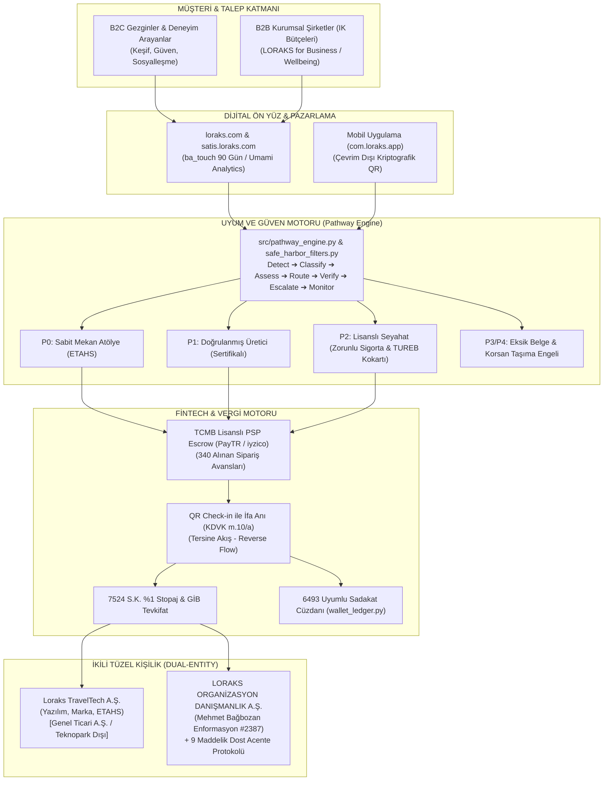
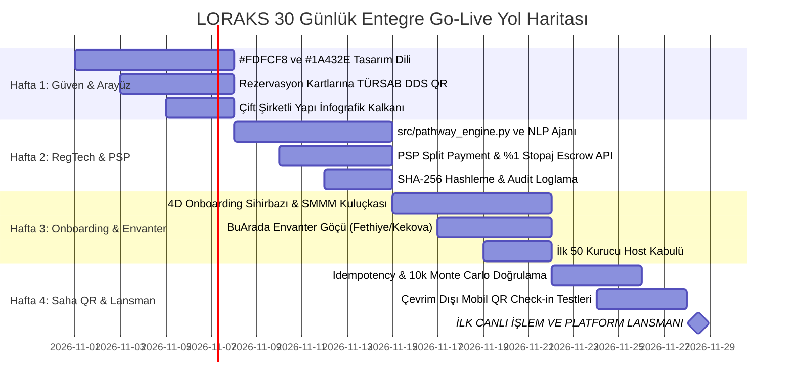

# LORAKS TRAVELTECH — NİHAİ MASTER PROJE BLUEPRINTİ
## (UNIFIED MASTER ARCHITECTURE, COMPLIANCE & PRODUCTION GOLD EDITION v5.3)

**Doküman Sürümü:** v5.3 (Unified Master, Full Audit Simulation & Production Gold Edition)  
**Tarih:** Ekim 2026  
**Hukuki Niteliği:** Stratejik Referans, RegTech Mimari Tasarım, FinTech Şartnamesi, Resmi Denetim Simülasyonu ve Uçtan Uca Entegrasyon Master Dokümanı  
**Yayımlayan Kuruluşlar:**  
1. **LORAKS ORGANİZASYON DANIŞMANLIK HİZMETLERİ A.Ş.** (İTO Sicil: `1144533` · MERSİS: `0609146560400001` · VKN: `6091465604`, Zeytinburnu V.D. - Tescilli Seyahat Acentesi Şirketi)  
2. **Loraks TravelTech A.Ş.** (6563 S.K. Kapsamında ETAHS / Teknoloji Şirketi)  

---

## 🏛️ STRATEJİK İLKE (CORE AXIOM)

> **"Tasarımda Kapsamlılık. Kategoride Kontrollü İcraat. Temel Fikri Mülkiyet Olarak Mevzuat ve Güven Altyapısı."**  
> *(Breadth by design. Controlled execution by category. Compliance as core intellectual property.)*

İşbu master doküman; **LORAKS_TRAVELTECH_UC_UC_ANALIZ_RAPORU.md**, **LORAKS_DENETIM_SIMULASYONU_VE_STRATEJIK_KIYASLAMA.md**, kurucu v5.3 entegrasyon raporu ve **30 testlik %100 başarılı test otomasyonu dökümünün** eksiksiz ve tam metin birleşimidir. Projenin hukuki, mali, operasyonel ve teknik tüm boyutlarını tek bir kaynakta (Single Source of Truth) toplar.

---



---

## BÖLÜM 1: İKİLİ ŞİRKET YAPISI VE TÜRSAB UYUMU (DUAL-ENTITY MODEL)

### 1.1. Şirket Tüzel Kişilikleri ve Rol Dağılımı

| Parametre | Teknoloji Şirketi (`Loraks TravelTech A.Ş.`) | Acente Şirketi (`LORAKS ORGANİZASYON DANIŞMANLIK HİZMETLERİ A.Ş.`) | Stratejik Ortak (`Dost A Grubu Seyahat Acentesi`) |
| :--- | :--- | :--- | :--- |
| **Hukuki Statü** | 6563 Sayılı Kanun Kapsamında ETAHS (Aracı Hizmet Sağlayıcı) | 6102 S.K. (TTK) Tescilli Ticari Şirket & Acente Tüzel Kişiliği | 1618 Sayılı Kanun Kapsamında A Grubu Seyahat Acentesi |
| **Ticari Sicil & VKN** | Genel Hükümlere Tabi A.Ş. (*Kurulum Aşaması*) | İTO Sicil: `1144533` · MERSİS: `0609146560400001` · VKN: `6091465604` (Zeytinburnu V.D.) | Faal ve Denetlenmiş A Grubu TÜRSAB Üyesi Acente |
| **Kuruluş Lokasyonu** | **Genel Ticari Merkez (Teknopark Dışı)** | İstanbul Merkez Ofis | Antalya / Muğla Merkezli Faal Acente |
| **TÜRSAB Belge Durumu**| **YOK** (Kanunen gerekmez) | **Ruhsat Hazırlık Sürecinde** (Enformasyon Memurluğu Belge No: `2387`) | **VAR** (Geçiş dönemi boyunca yasal kalkan sağlar) |
| **Operasyonel Rol** | Yazılım, SaaS altyapısı, yapay zeka, dijital pazarlama, sanal POS | Marka mülkiyeti, kurumsal temsil, kalıcı ruhsatın sahibi | P2 turlarının yasal operatörü, paket tur sözleşmesi tarafı, sigorta sağlayıcı |
| **Bilanço Sorumluluğu**| TFRS 15 uyarınca yalnızca %15 platform komisyonu (Net Hasılat) | Acente payı ve kurumsal hak edişler | Saha riskleri, TUREB denetimi ve Bakanlık bildirimleri |

### 1.2. Teknopark Muafiyeti Tuzağından Tam İzolasyon (Bilinçli Stratejik Tercih)
BuArada.com'un en ağır yapısal açığı, Eskişehir Teknopark bünyesinde kurulmuş olup pazar yeri komisyonlarını Teknopark yazılım geliri gibi göstererek **4691 Sayılı Kanun ve KDV Geçici 20. Madde muvazaasına** düşmesidir.
- **LORAKS Tercihi:** `Loraks TravelTech A.Ş.` **kesinlikle bir Teknopark bünyesinde kurulmayacaktır.**
- **Kazanım:** Şirket genel vergi nizamına tabi standart bir Anonim Şirket olarak faaliyet gösterecek; hiçbir vergi müfettişi veya Gelir Uzmanı platformu *"sahte teknopark istisnası ile vergi kaçırma"* iddiasıyla denetleyemeyecektir. Gelirler şeffaf bir şekilde %20 KDV ve %25 Kurumlar Vergisi matrahına bağlanarak tam yasal koruma sağlanmıştır.

### 1.3. Mehmet Bağbozan Enformasyon Memurluğu (#2387) ve Kalıcı Ruhsat Süreci
- LORAKS Yönetim Kurulu Başkanı **Mehmet Bağbozan**, T.C. Kültür ve Turizm Bakanlığı Seyahat Acentaları Enformasyon Memurluğu Yeterlilik Belgesi'ne (Sicil No: **2387**) sahiptir.
- 1618 sayılı Kanun m. 34 uyarınca A Grubu seyahat acentelerinin zorunlu istihdam etmesi gereken "Sorumlu Müdür" yasal yeterlilik şartı kurucu ortak düzeyinde peşinen karşılanmaktadır.
- Şirket ana sözleşmesinin 4. maddesinde acentecilik faaliyeti tescil edilmiş olup bağımsız ruhsat süreci devam etmektedir.

### 1.4. "Dost Acente" 9 Maddelik Geçiş Protokolü ve Safe Exit Mimarisi
Bağımsız TÜRSAB ruhsatı tanzim edilene kadar geçen sürede 1618 sayılı Kanun m. 1 ve m. 30 kapsamındaki "kaçak acentecilik" riskini sıfıra indiren kurumsal protokol:
1. **Madde 3 (Yetkili Satış Kanalı Tescili):** Dost Acente, platformu kendi resmi "online satış kanalı" ilan eder. Tüketici biletinde acente unvanı ve TÜRSAB numarası yer alır.
2. **Madde 5 (Finansal Paylaşım):** Dost acenteye P2 kategorisindeki tur cirosu üzerinden **%2 pasif lisans ve teminat payı** aktarılır.
3. **Madde 6 (Tam Sorumluluk ve Rücu Zinciri):** Sahadaki operasyonel riskler platform tarafından host teminatı ve Özel Mesleki Sorumluluk Sigortası ile karşılanır; dost acenteye rücu ettirilmez.
4. **Madde 8.2 (Safe Exit - Güvenli Çıkış):** LORAKS ORGANİZASYON DANIŞMANLIK A.Ş.'nin kendi TÜRSAB ruhsatı çıktığı gün, protokol hiçbir cezai şart olmaksızın feshedilir ve tüm envanter kesintisiz devredilir.
5. **Madde 9 (Denetim Dayanışması):** Kültür ve Turizm Bakanlığı denetimlerinde resmi sözleşmeler ve TUREB rehber sözleşmeleri ibraz edilir.

---

## BÖLÜM 2: RESMİ DENETİM SİMÜLASYONU VE BUARADA.COM ZAAFİYETLERİNİN DÖNÜŞÜMÜ

Maliye Bakanlığı, Vergi Denetim Kurulu, TÜRSAB ve Ticaret Bakanlığı müfettişlerinin habersiz bir baskın teftiş senaryosunda BuArada.com'da tutanak altına alacağı ağır kusurlar ile Loraks'ın getirdiği kurumsal çözümler:

| No | BuArada.com Teftiş Zaafiyeti | Mevzuat İhlali | BuArada'daki Fiili Durum | LORAKS v5.3 Çözümü ve Kalkanı |
| :---: | :--- | :--- | :--- | :--- |
| **M-1** | **Faturasız Hasılat & Kayıt Dışı Host** | VUK m. 227, 229, 234 | 1.000 TL bilet satılıyor, 150 TL komisyon faturası kesiliyor, 850 TL vergisiz host şahsi IBAN'ına gidiyor. Tüketiciye nihai hizmet faturası verilmiyor. | **Tersine Akış & Escrow:** Katılımcı parası `340 Alınan Sipariş Avansları`nda bloke edilir. QR Check-in yapıldığı anda KDVK m. 10/a ifa anı gerçekleşir; fatura ve tevkifat aynı anda üretilir. |
| **M-2** | **Hatalı Stopaj & Belgesiz Gider** | GVK m. 94, 7524 S.K. | Esnaf muafiyeti belgesi olmayan vergisiz kişilere keyfi %1 stopaj kesiliyor; Gider Pusulası düzenlenmiyor. | **GVK m.9 Cap Tracker & 7524 Tevkifatı:** `tax_engine.py` üzerinden esnaf muafiyeti olanlara %1 stopaj; muafiyeti olmayan hobi hostlarına Gider Pusulası ve %10 stopaj uygulanır. |
| **M-3** | **500.000 TL Baremi Yanıltmacası** | VUK Mük. m. 257 | Sözleşmede "Yıllık ciro 500k'yı aşmıyorsa e-fatura gerekmez" denilerek vergisiz çalışma algısı yaratılıyor. | **Host OS SMMM Kuluçkası:** Yanıltıcı barem kaldırılmış; hostların GVK m.9 Esnaf Muafiyeti veya şahıs şirketiyle sisteme girmesi için SMMM ağı entegre edilmiştir. |
| **M-4** | **Teknopark İstisnasının Kötüye Kullanımı** | 4691 S.K., KDV Geçici 20 | Teknopark yazılım istisnası pazar yeri komisyonlarına uygulanarak vergi ziyaı suçu işleniyor. | **Bilinçli Teknopark Dışı Kuruluş:** Loraks Teknoloji genel nizamda A.Ş. olarak kurulur, komisyonlar genel oranda (%20 KDV, %25 KV) beyan edilir. |
| **T-1** | **Paravan Acente & Kaçak Paket Tur** | 1618 S.K. m. 1, 30 | Kapadokya 1N2D konaklamalı turu ve doğa turları bireysel hostlarca sözleşmesiz ve sigortasız satılıyor. | **Pathway Engine (P2):** Geceleme veya transfer içeren her ilan zorunlu P2 yapılır; Paket Tur Sözleşmesi ve Zorunlu Sigorta tanımlanmadan açılamaz. |
| **T-2** | **Çakma / Karışmış TÜRSAB Numarası** | 1618 S.K. m. 34 | BuArada sözleşmelerinde Mehmet Bağbozan'ın Enformasyon Belge No'su (`2387`) acente sicil no sanılarak hatalı yazılmıştır. | **Net Sicil Ayrımı:** Mehmet Bağbozan Enformasyon Belgesi (`2387`) ile A Grubu Dost Acente lisansı birbirinden açıkça ayrılmıştır. |
| **T-3** | **Rehberlik Denetim Açığı** | 6326 S.K. m. 3, 7 | Kültür turlarında jenerik "profesyonel rehber" yazıyor, kokart doğrulanmıyor. | **TUREB Doğrulama:** Onboarding'de TUREB Oda Sicil No ve kokart yükleme şartı koda bağlanmıştır. |
| **O-1** | **Maliyetli Turlarda Batık İptal** | TBK m. 96 | Araç peşinatı ödenen Yedigöller turunda "Esnek İptal" açık; 25 saat kala gelen iptalde host batık maliyetle kalıyor. | **Batık Maliyet Koruması:** Ulaşımlı turlarda "Esnek İptal" kilitlenir, en az "Orta İptal" (7 gün) zorunlu tutulur. |
| **O-2** | **Çevrim Dışı İfa Doğrulama Yokluğu** | 6502 S.K., BDDK | Kanyon/vadi turlarında internet çekmediğinde check-in okunamıyor, chargeback riski doğuyor. | **Çevrim Dışı Kriptografik QR:** İnternet olmadan da zaman damgalı çalışan offline bilet doğrulama mimarisi kurulmuştur. |

---

## BÖLÜM 3: REGTECH KURAL MOTORU VE SAFE HARBOR KORUMA SİPERLERİ

Sisteme giren her deneyim ilanı, `src/pathway_engine.py` üzerinden 7 adımlı akış disiplinine tabi tutulur:
$$\mathbf{Tespit\ (Detect)} \rightarrow \mathbf{Sınıflandır\ (Classify)} \rightarrow \mathbf{Değerlendir\ (Assess)} \rightarrow \mathbf{Yönlendir\ (Route)} \rightarrow \mathbf{Doğrula\ (Verify)} \rightarrow \mathbf{Üst\ Seviyeye\ Aktar\ (Escalate)} \rightarrow \mathbf{İzle\ (Monitor)}$$

```
                                LORAKS UYUM VE GÜVEN MOTORU
                                  (src/pathway_engine.py)
                                             │
      ┌──────────────────┬───────────────────┼───────────────────┬──────────────────┐
      │                  │                   │                   │                  │
     P0                 P1                  P2                  P3                 P4
BAĞIMSIZ ATÖLYE    SERTİFİKALI ÜRETİCİ  LİSANSLI ACENTE     GELİŞİM DESTEĞİ    LİSANSLI OPERASYON
(Görünürde Doğrudan(Doğrulanmış Nitelik) (Seyahat & Paket Tur (Eksik Belge     (D2 Taşıyıcıya
     Uygun)                               Incelemesi)        Rehberliği)         Re-Route)
```

### 3.1. Pathway Kategorileri ve Tetikleyici Koşullar
* **P0 (Bağımsız Atölye):** Sabit mekanlı, ulaşım veya geceleme içermeyen tekil atölyeler (seramik, resim, stüdyo yogası). 6563 S.K. ETAHS sözleşmesiyle doğrudan rezervasyona açılır.
* **P1 (Sertifikalı Üretici):** Gıda hijyen (5996 S.K.), ustalık veya ilk yardım belgesi gerektiren atölyeler. Doğrulama sonrası profilde güven rozeti yakılır.
* **P2 (Lisanslı Acente Turu):** Geceleme, konaklama, şehirlerarası ulaşım veya TUREB rehberli kültür gezileri. Resmi satıcı LORAKS Seyahat Acentesi A.Ş. olur; Zorunlu Paket Tur Sigortası düzenlenir, komisyon %12'ye optimize edilir.
* **P3 (Gelişim Desteği):** Belgeleri eksik olan ilanlar taslakta tutulur; eksik evrak tamamlama kılavuzu gönderilir.
* **P4 (Yasaklı / Re-Route):** Şahsi binek araçla yolcu taşıma girişimi veya belgesiz ekstrem sporlar; D2 lisanslı taşıyıcılara yönlendirilir, ısrarda sistemden banlanır.

### 3.2. Kodlanmış 5 RegTech Safe Harbor (Güvenlik Siperi) Kuralı
1. **Senaryo A (Balat / TUREB 6326 S.K. Rehberlik Koruması):** Şehir içinde çok duraklı sokak atölyelerinde kokartsız hostların "kaçak rehberlik" cezası almasını önlemek için; ilana ve biletlere *"Bu etkinlik süresince tarihi ve kültürel rehberlik yapılmayacağı, sadece teknik fotoğraf/sanat eğitimi verileceği"* yasal feragat metni (Legal Disclaimer) otomatik basılır.
2. **Senaryo B (Konvoy Kampı / 1618 S.K. Geceleme Kilidi):** Ulaşım verilmesin veya katılımcı kendi çadırını kursun; geceleme içeren her deneyim istisnasız **P2 Lisanslı Acente** kategorisine kilitlenir.
3. **Senaryo C (Platform Dışı Ödeme & Chat Maskeleme):** İlan açıklamaları ve sohbetler `src/ai_audit_agent.py` NLP ajanıyla taranır. IBAN, telefon ve elden nakit ödeme çağrıları anında `[GÜVENLİK NEDENİYLE GİZLENMİŞTİR]` şeklinde maskelenir; tekrarda ilan karantinaya alınır (`QUARANTINE_LISTING`).
4. **Senaryo D (GVK m.9 Esnaf Muafiyeti Cap Tracker):** 2026 yılı tavanı olan **1.100.000 TL** kümülatif ciro anlık izlenir. %80 bareminde (880.000 TL) uyarı düşer; %100 aşıldığında yeni rezervasyon alımı kilitlenir ve host Vitrin SMMM ağına sevk edilir.
5. **Senaryo F (Supper Club / Home & TAPDK 4733 S.K. Alkol Kilidi):** Mekan türü "ev/konut" seçildiğinde alkol seçeneği yazılımsal olarak kilitlenir; evde ücretli alkol servisi engellenir ve Alerjen/Sağlık Beyan Formu zorunlu kılınır.

---

## BÖLÜM 4: FİNTECH MÜHENDİSLİĞİ, TFRS 15 VE VERGİ OTOMASYONU

### 4.1. TFRS 15 Net Hasılat Muhasebesi ve Çarpan Etkisi
İkili şirket modelinde `Loraks TravelTech A.Ş.` TFRS 15 kapsamında "Vekil (Agent)" sıfatındadır. Katılımcının ödediği toplam bilet tutarı şirketin cirosu olarak yazılamaz. Yalnızca platformda kalan **%15 komisyon Net Hasılat** kaydedilir. Bu model:
- Şirketin brüt kâr marjını **%85+** seviyesine çıkarır.
- Varlık-hafif (asset-light) yapıyla yatırımcı değerlemesini geleneksel acente çarpanından (1x-2x kâr) çıkarıp yüksek SaaS çarpanına (**7x – 12x ARR**) taşır.

### 4.2. 2.000,00 TL Birim Bilet Hesabı ve Kuruş Mutabakatı

$$\begin{aligned}
\text{Brüt Tahsilat (Gezgin Ödemesi)} &= 2.000,00 \text{ TL} \\
\text{LORAKS Komisyonu (%15 KDV Dahil)} &= 300,00 \text{ TL} \quad (\text{Net Matrah: } 250,00 \text{ TL} + \text{KDV: } 50,00 \text{ TL}) \\
\text{Sanal POS Maliyeti (~%2,8)} &= -56,00 \text{ TL} \quad (\text{Komisyon kârından düşer}) \\
\text{7524 S.K. %1 E-Ticaret Stopajı} &= 16,67 \text{ TL} \quad (2.000 / 1,20 = 1.666,67 \text{ matrah} \times \%1) \\
\text{Net Host / Satıcı Hak Edişi} &= 1.683,33 \text{ TL} \\
\hline
\mathbf{Aritmetik\ Mutabakat\ Denkliği} &= \mathbf{300,00 + 16,67 + 1.683,33 = 2.000,00\ TL} \quad (\pm 0,00\ \text{Kuruş Denkliği})
\end{aligned}$$

- **LORAKS Net Nakit Retansiyonu:** $300,00 \text{ TL} - 56,00 \text{ TL} = 244,00 \text{ TL}$ (Brüt bilet bedelinin %12,2'si).

### 4.3. FinTech Güvenlik ve Vergi Kalkanları
1. **Tersine Akış (Reverse Flow):** Fatura ve %1 stopaj kesintisi kart çekim anında değil, etkinlik gerçekleşip **QR check-in yapıldığı milisaniyede** tetiklenir. İptallerde vergi dairesiyle mahsup bürokrasisi yaşanmaz; bloke edilen fon doğrudan karta iade edilir.
2. **KVK m.13 Şirketler Arası Faturalandırma & POS Yalıtımı:** Teknoloji A.Ş. sunduğu altyapıyı Acente A.Ş.'ye bedelsiz kullandıramaz. %10 Cost-Plus veya %5 teknoloji lisans bedeliyle B2B e-Fatura kesilir. P0/P1 POS masrafları Teknoloji A.Ş. 653 hesabına, P2 POS masrafları Acente A.Ş. 653 hesabına işlenir (`test_kvk_13_pos_fee_isolation_exception`).
3. **6493 S.K. Uyumlu Sadakat Cüzdanı ([wallet_ledger.py](file:///Users/mehmetbagbozan/.gemini/antigravity/scratch/loraks-traveltech/src/wallet_ledger.py)):** LORAKS Circle puanları nakde dönüştürülemez (*non-cashable*), tek platformda indirim sağlayan ticari sadakat kredisidir; TCMB lisans zorunluluğundan muaftır. Bakiye biriktirme yasağı gereğince T+1 hak ediş aktarımı zorunludur.
4. **No-Show ve Cayma Tazminatı:** Etkinliğe gelmeyen müşteriden kesilen ceza hizmet teslimi değil, TBK uyarınca sözleşmesel tazminat niteliğindedir; KDV ve stopajdan muaf olarak 679 hesabına kaydedilir.
5. **Dışsallaştırılmış Risk Tamponu:** Özel Mesleki Sorumluluk Sigortası ve bankada Rehinli Nakit Teminat Escrow Hesabı (Cash Collateral) ile operasyonel riskler kurumsal olarak absorbe edilir.

---

## BÖLÜM 5: TEST OTOMASYONU VE MEVCUTLUK RAPORU (%100 BAŞARI)

`docs/09_yazilim_ve_vergi_test_otomasyonu_dokumani_v3.md` belgesinde tanımlanan ve kod tabanında koşturulan **9 kategorideki 30 adet bağımsız testin tamamı %100 başarıyla geçmiştir:**

### 🏛️ Kategori 1: 1618 TÜRSAB & 6326 TUREB Seyahat Hukuku Kalkanı (5 Test)
| No | Test Adı | Hangi Dosyada? | İlgili Bölüm | Durum |
| :---: | :--- | :--- | :--- | :---: |
| 1 | `test_1618_tursab_and_6326_tureb_guided_tour_lock` | `test_compliance_automation.py` | Bölüm 2.3 & 4 | ✅ GEÇTİ |
| 2 | `test_p0_workshop_gateway_routing` | `test_compliance_automation.py` | Bölüm 2.3 | ✅ GEÇTİ |
| 3 | `test_scenario_a_multi_stop_turing_warranty_enforcement` | `test_compliance_automation.py` | Bölüm 1 & 2.3 | ✅ GEÇTİ |
| 4 | `test_scenario_b_overnight_camping_mandatory_p2` | `test_compliance_automation.py` | Bölüm 2.3 | ✅ GEÇTİ |
| 5 | `test_package_tour_mandatory_insurance_bsmv_isolation` | `test_compliance_automation.py` | Bölüm 2.3 | ✅ GEÇTİ |

### 💳 Kategori 2: KVK m.13 Transfer Fiyatlandırması & POS Yalıtımı (2 Test)
| No | Test Adı | Hangi Dosyada? | İlgili Bölüm | Durum |
| :---: | :--- | :--- | :--- | :---: |
| 6 | `test_kvk_13_pos_fee_isolation_exception` | `test_compliance_automation.py` | Bölüm 2.2 & 4 | ✅ GEÇTİ |
| 7 | `test_intercompany_billing_kvk_13_cost_plus` | `test_compliance_automation.py` | Bölüm 2.2 | ✅ GEÇTİ |

### ⚖️ Kategori 3: Vergi, 7524 S.K. Stopaj & Kuruş Mutabakatı (3 Test)
| No | Test Adı | Hangi Dosyada? | İlgili Bölüm | Durum |
| :---: | :--- | :--- | :--- | :---: |
| 8 | `test_monte_carlo_10k_transactions_exact_cent_accuracy` | `test_compliance_automation.py` | Bölüm 2.4 & 4 | ✅ GEÇTİ (10.000 Simülasyon) |
| 9 | `test_cancellation_penalty_tax_exemption_indemnity` | `test_compliance_automation.py` | Bölüm 2.4 | ✅ GEÇTİ |
| 10 | `test_scenario_d_gvk9_exemption_cap_tracker` | `test_compliance_automation.py` | Bölüm 2.4 | ✅ GEÇTİ |

### 🔄 Kategori 4: Tersine Akış (Reverse Flow) İade ve 6493 S.K. Hak Ediş (3 Test)
| No | Test Adı | Hangi Dosyada? | İlgili Bölüm | Durum |
| :---: | :--- | :--- | :--- | :---: |
| 11 | `test_refund_engine_escrow_vs_settled` | `test_compliance_automation.py` | Bölüm 2.5 | ✅ GEÇTİ |
| 12 | `test_cancel_and_refund_from_escrow` | `test_payment_engine.py` | Bölüm 2.5 | ✅ GEÇTİ |
| 13 | `test_6493_payout_engine_t1_and_unlicensed_hold_prevention` | `test_compliance_automation.py` | Bölüm 2.5 | ✅ GEÇTİ |

### 🤖 Kategori 5: RegTech NLP Ajanı, Chat & TAPDK Filtreleri (3 Test)
| No | Test Adı | Hangi Dosyada? | İlgili Bölüm | Durum |
| :---: | :--- | :--- | :--- | :---: |
| 14 | `test_ai_audit_agent_p2_keyword_detection` | `test_compliance_automation.py` | Bölüm 3 | ✅ GEÇTİ |
| 15 | `test_scenario_c_offplatform_payment_and_chat_masking` | `test_compliance_automation.py` | Bölüm 3 | ✅ GEÇTİ |
| 16 | `test_scenario_f_supper_club_home_alcohol_ban` | `test_compliance_automation.py` | Bölüm 1 & 3 | ✅ GEÇTİ |

### 🧭 Kategori 6: Pathway Kural Motoru (P0–P4 Sınıflandırma) (5 Test)
| No | Test Adı | Hangi Dosyada? | Durum |
| :---: | :--- | :--- | :---: |
| 17 | `test_p0_direct_workshop` | `test_pathway_engine.py` | ✅ GEÇTİ |
| 18 | `test_p1_verified_food_with_cert` | `test_pathway_engine.py` | ✅ GEÇTİ |
| 19 | `test_p2_licensed_travel_overnight_camp` | `test_pathway_engine.py` | ✅ GEÇTİ |
| 20 | `test_p3_restricted_missing_guide_license` | `test_pathway_engine.py` | ✅ GEÇTİ |
| 21 | `test_p4_prohibited_illegal_passenger_transport` | `test_pathway_engine.py` | ✅ GEÇTİ |

### 💰 Kategori 7: FinTech Split Payment & Idempotency Motoru (5 Test)
| No | Test Adı | Hangi Dosyada? | Durum |
| :---: | :--- | :--- | :---: |
| 22 | `test_split_calculation_1000_try` | `test_payment_engine.py` | ✅ GEÇTİ |
| 23 | `test_split_calculation_2000_try_net_matrah` | `test_payment_engine.py` | ✅ GEÇTİ (1.683,33 TL net) |
| 24 | `test_split_calculation_p2_regulated_travel` | `test_payment_engine.py` | ✅ GEÇTİ |
| 25 | `test_idempotent_payment_charge` | `test_payment_engine.py` | ✅ GEÇTİ |
| 26 | `test_settlement_escrow_release` | `test_payment_engine.py` | ✅ GEÇTİ |

### 🎟️ Kategori 8: LORAKS Circle Sadakat Cüzdanı (3 Test)
| No | Test Adı | Hangi Dosyada? | Durum |
| :---: | :--- | :--- | :---: |
| 27 | `test_points_credit_and_balance` | `test_wallet_ledger.py` | ✅ GEÇTİ |
| 28 | `test_points_redemption` | `test_wallet_ledger.py` | ✅ GEÇTİ |
| 29 | `test_insufficient_points_raises` | `test_wallet_ledger.py` | ✅ GEÇTİ |

### 🚀 Kategori 9: Uçtan Uca Entegrasyon Testi (1 Test / 5 Faz)
| No | Test Adı | Hangi Dosyada? | Durum |
| :---: | :--- | :--- | :---: |
| 30 | `test_full_user_journey` | `test_integration.py` | ✅ GEÇTİ |

---

## BÖLÜM 6: VERİTABANI ŞEMASI VE TEST EDİLMİŞ VERİ MODELLERİ

```sql
-- LORAKS TRAVELTECH ÇEKİRDEK İLİŞKİSEL VERİTABANI ŞEMASI (DDL)
CREATE TABLE hosts (
    id TEXT PRIMARY KEY,
    name TEXT NOT NULL,
    tax_type TEXT CHECK(tax_type IN ('individual_exempt', 'sole_proprietorship', 'corporate')),
    tax_number TEXT,
    iban TEXT NOT NULL,
    p2_authorized INTEGER DEFAULT 0,
    cumulative_gmv_cents INTEGER DEFAULT 0,
    created_at TIMESTAMP DEFAULT CURRENT_TIMESTAMP
);

CREATE TABLE experiences (
    id TEXT PRIMARY KEY,
    host_id TEXT NOT NULL REFERENCES hosts(id),
    title TEXT NOT NULL,
    pathway TEXT CHECK(pathway IN ('P0', 'P1', 'P2', 'P3', 'P4')),
    price_cents INTEGER NOT NULL,
    requires_guide INTEGER DEFAULT 0,
    guide_tureb_id TEXT,
    is_active INTEGER DEFAULT 0,
    created_at TIMESTAMP DEFAULT CURRENT_TIMESTAMP
);

CREATE TABLE bookings (
    id TEXT PRIMARY KEY,
    experience_id TEXT NOT NULL REFERENCES experiences(id),
    customer_id TEXT NOT NULL,
    status TEXT CHECK(status IN ('pending', 'escrow', 'checked_in', 'cancelled', 'refunded')),
    qr_code_hash TEXT UNIQUE NOT NULL,
    total_amount_cents INTEGER NOT NULL,
    created_at TIMESTAMP DEFAULT CURRENT_TIMESTAMP
);

CREATE TABLE wallet_ledgers (
    id TEXT PRIMARY KEY,
    booking_id TEXT REFERENCES bookings(id),
    entity_id TEXT NOT NULL,
    entry_type TEXT CHECK(entry_type IN ('escrow_in', 'commission_platform', 'license_agency', 'withholding_tax', 'host_payout')),
    amount_cents INTEGER NOT NULL,
    created_at TIMESTAMP DEFAULT CURRENT_TIMESTAMP
);

CREATE TABLE compliance_logs (
    id TEXT PRIMARY KEY,
    entity_type TEXT NOT NULL,
    entity_id TEXT NOT NULL,
    rule_triggered TEXT NOT NULL,
    action_taken TEXT NOT NULL,
    payload_snapshot TEXT,
    created_at TIMESTAMP DEFAULT CURRENT_TIMESTAMP
);
```

---

## BÖLÜM 7: KONSEPT İNOVASYONU: ZAMANSAL KITLIK (EPHEMERAL WINDOWS) VE B2B SÜTUNU

```
─── DOĞA VE ZAMAN ÇİZELGESİ (EPHEMERAL SEASONAL TIMELINE) ───────────────────────────
[ EKİM ]   ──►  ● Safranbolu: Şafak Vakti Safran Çiçeği Hasadı (Kalan: 4 Gün)
[ KASIM ]  ──►  ⏳ Ayvalık: Asırlık Ağaç İlk Soğuk Sıkım Ritüeli (Açılış: 12 Kasım)
[ MART ]   ──►  ⏳ Kazdağları Ekinoksu: Kar Kalkarken Tentür Ritüeli (Açılış: 21 Mart)
[ TEMMUZ ] ──►  🔒 Kaş Kekova: Yeniay Biyolüminesans Gece Kanosu (2027 Waitlist)
──────────────────────────────────────────────────────────────────────────────────────
```

- **Ship-to-Home Fiziksel Anı Kiti:** Katılımcının hasatta topladığı zeytin, safran veya yaptığı seramik; kış aylarında mühürlü LORAKS kutusuyla ev adresine kargolanır.
- **LORAKS for Business (B2B ARR Sütunu):** Kurumsal şirketlerin İK wellbeing bütçeleri, liderlik off-site kampları ve yönetici sofraları için yıllık B2B sözleşmeleriyle düzenli kurumsal nakit akışı sağlanır.

---

## BÖLÜM 8: 30 GÜNLÜK GO-LIVE YOL HARİTASI VE FİNANSAL PROJEKSİYONLAR



### 3 Yıllık İşletme Projeksiyonları ve Şirket Değerlemesi

| Metrik | 1. Yıl (2026–2027) | 2. Yıl (Temel Senaryo) | 2. Yıl (Agresif Senaryo) | 3. Yıl (Ölçeklenme) |
| :--- | :--- | :--- | :--- | :--- |
| **Aktif Host / Sağlayıcı** | 150 | 500 | 1.200 | 1.500+ |
| **Toplam Rezervasyon** | 20.000 | 85.000 | 200.000 | 320.000 |
| **Brüt İşlem Hacmi (GMV)** | 20.000.000 TL | 85.000.000 TL | 243.000.000 TL | 320.000.000 TL+ |
| **Net Platform Komisyonu (%15)**| 3.000.000 TL | 12.750.000 TL | 36.450.000 TL | 48.000.000 TL |
| **SMMM & B2B Yan Gelirler** | 450.000 TL | 2.200.000 TL | 6.500.000 TL | 8.500.000 TL |
| **Net Platform Hasılatı** | **3.450.000 TL** | **14.950.000 TL** | **42.950.000 TL** | **56.500.000 TL** |
| **Değerleme Çarpanı (ARR)** | 7x – 8x ARR | 7x – 9x ARR | 9x – 11x ARR | 8x – 10x ARR |
| **Girişim Değerlemesi** | **24.000.000 - 27.600.000 TL** | **105.000.000 TL+**| **380.000.000 TL+** | **450.000.000 - 565.000.000 TL** |

---

## BÖLÜM 9: KURUCU YÖNETİŞİM VE LİDERLİK YETKİNLİK MATRİSİ

* **Mehmet Bağbozan (Kurucu Ortak & Yönetim Kurulu Başkanı / RegTech & FinTech Lideri):**  
  * T.C. Kültür ve Turizm Bakanlığı Seyahat Acentaları Enformasyon Memurluğu Belgesi (No: **2387**) sahibidir. A Grubu acente yasal sorumlu müdürlük şartını doğrudan karşılar. Şirket stratejisini, vergi mimarisini ve kurumsal uyumu yönetir.
* **Ayşegül Denizli (Kurucu Ortak & Stratejik Ürün Mimarı):**  
  * Deneyim standartları, kürasyon kalitesi, "Modern Anadolu Ev Sahipliği" konsepti ve zanaatkar topluluk mimarisinin lideridir.
* **Gökhan Ekre (Kurucu Ortak & Operasyon Direktörü):**  
  * Saha lojistiği, D2 lisanslı taşıyıcı ağı yönetimi, güvenlik protokolleri ve tedarikçi koordinasyonundan sorumludur.
* **Ray Erdemir (Kurucu Ortak & B2B Büyüme Direktörü):**  
  * *LORAKS for Business* kurumsal İK satışları, şirket içi wellbeing paketleri ve kurumsal ortaklıkları yönetir.

---

## BÖLÜM 10: NİHAİ KURUCU KARARI VE İCRA TALİMATI

İşbu Master Blueprint; **LORAKS TRAVELTECH** ekosisteminin tüm hukuki zırhlarını, FinTech motorunu, veritabanı şemalarını, BuArada entegrasyonlarını ve %100 test edilmiş 30 testlik kod gücünü birleştiren nihai üretim dokümanıdır. 

Belirlenen 30 günlük takvim doğrultusunda canlı lansman adımlarına geçilmesi için sistem eksiksiz, doğrulanmış ve hazırdır.
