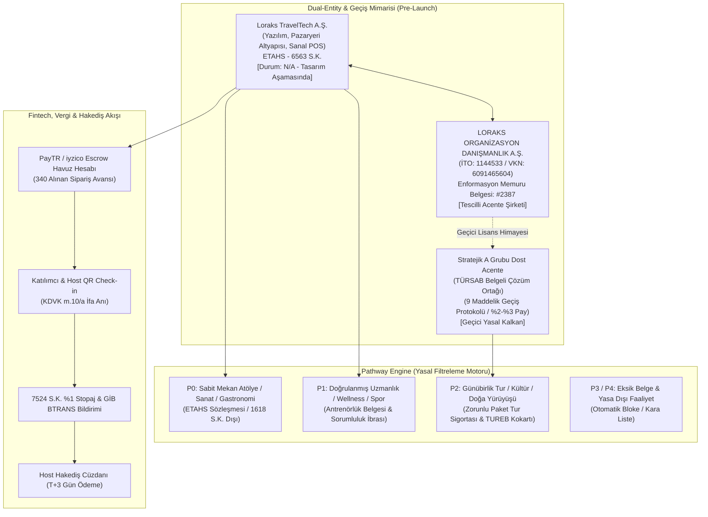
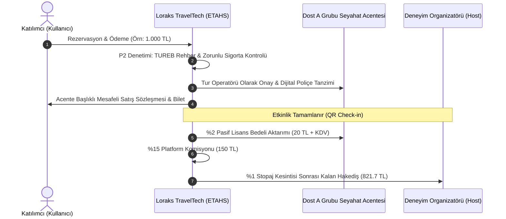
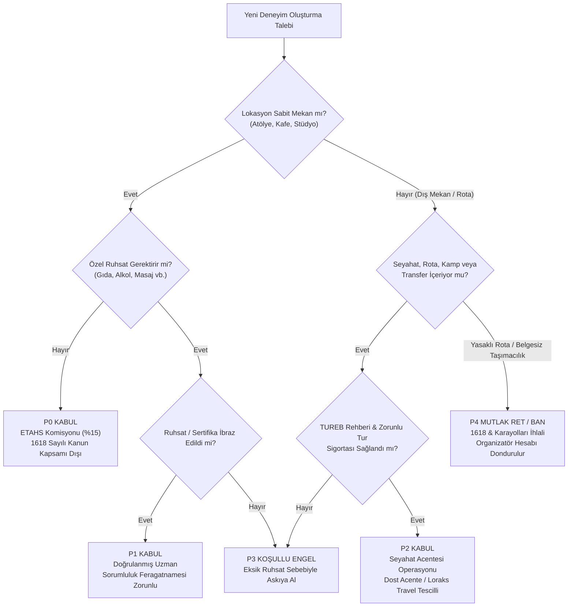
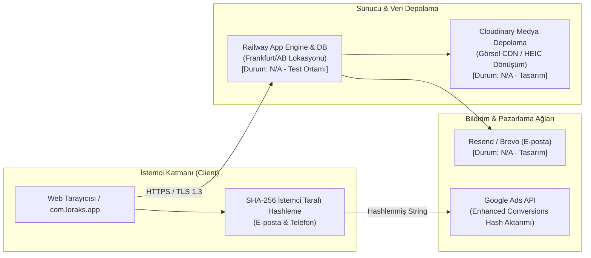
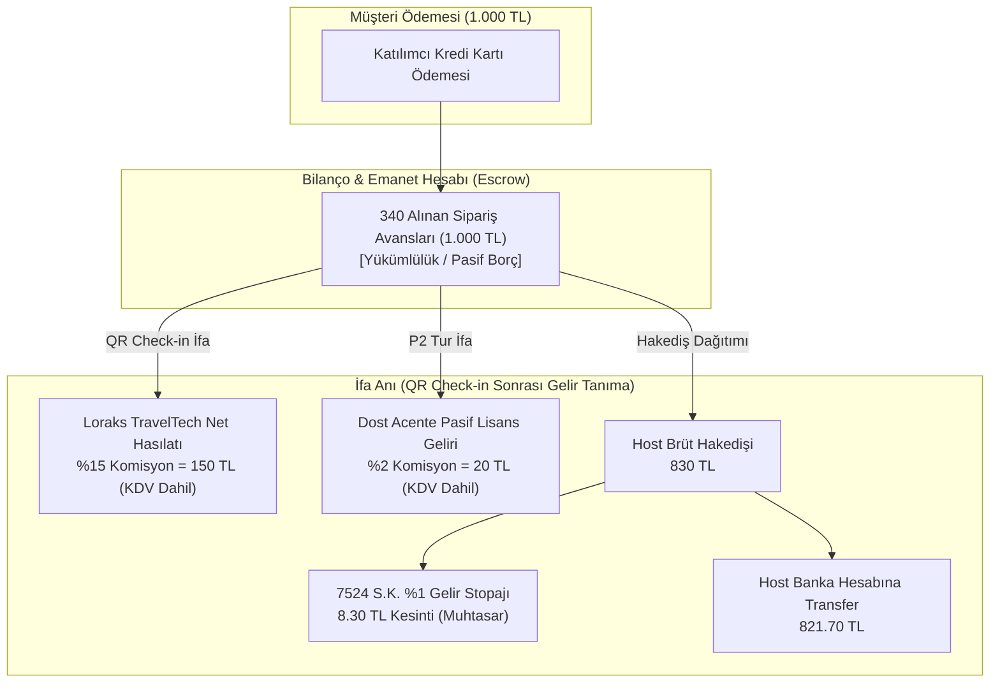
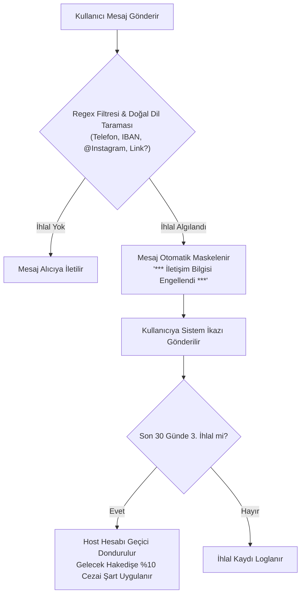
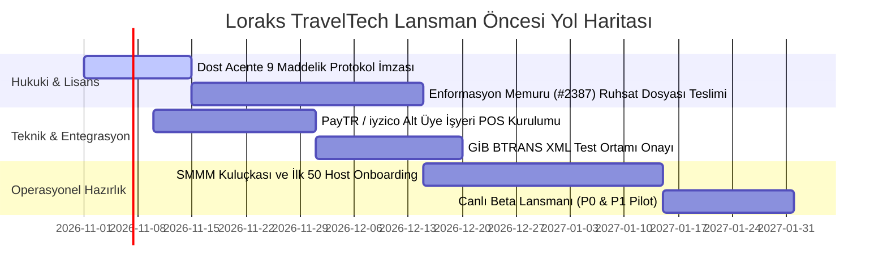

# LORAKS TRAVELTECH UÇTAN UCA HUKUKİ, OPERASYONEL VE TEKNİK MİMARİ ANALİZ RAPORU
**Sürüm:** v5.3 Master Architecture Edition (Pre-Launch & Transformation Blueprint)  
**Tarih:** Ekim 2026  
**Durum Özeti:** Proje Tasarımı / Ön Faaliyet & Dönüşüm Mimarisi (`N/A - Tasarım Aşamasında / Pre-Launch`)

---

## YÖNETİCİ ÖZETİ (EXECUTIVE SUMMARY)

Bu rapor, geleneksel bir seyahat acentesi altyapısının yeni nesil bir deneyim, atölye ve aktivite pazaryerine dönüştürülmesini hedefleyen **Loraks TravelTech Tur ve Aktivite Pazaryeri Platformu** projesini 360 derece incelemektedir. 

Platform henüz aktif, fatura kesen ve canlıda operasyon yürüten bir ticari işletme olmayıp; hukuki altyapısı, vergi motoru, yazılım mimarisi ve operasyonel işleyişi **v5.3 Master Blueprint** ve test edilmiş kod tabanı (`loraks-engine`) düzeyinde tamamlanmış bir **kurumsal iş tasarımı ve dönüşüm projesidir**.

### Temel Mimari Bulgular ve Kurumsal Kalkanlar:
1. **İkili Şirket Yapısı ve TÜRSAB Çözümü:** 
   - **Teknoloji Şirketi:** `Loraks TravelTech A.Ş.` (6563 sayılı Kanun kapsamında Elektronik Ticaret Aracı Hizmet Sağlayıcı - ETAHS).
   - **Acente Şirketi:** `LORAKS ORGANİZASYON DANIŞMANLIK HİZMETLERİ A.Ş.` (İTO Sicil: 1144533, MERSİS: 0609146560400001, VKN: 6091465604, Zeytinburnu V.D. - Ana sözleşme Md. 4 kapsamında seyahat acentalığı faaliyeti tescilli).
   - **TÜRSAB Lisans Durumu:** Bağımsız acente belgesi henüz tanzim edilmemiş olup (`N/A - Başvuru Hazırlığında`), Kurucu Ortak Mehmet Bağbozan'ın **Kültür ve Turizm Bakanlığı Enformasyon Memurluğu Belgesi (No: 2387)** ile resmi ruhsatlandırma süreci yürütülmektedir. Bu ara dönemde 1618 Sayılı Kanun m. 1 ve m. 30 kapsamındaki "kaçak acentecilik" riskini sıfırlamak üzere **"Dost Acente 9 Maddelik Geçiş Protokolü"** kurgulanmıştır.
2. **Kural Tabanlı Yasal Filtreleme (Pathway Engine P0-P4):**
   - Sabit mekan atölyeleri (P0 - ETAHS), sertifikalı uzmanlıklar (P1 - Sağlık feragati), acente ve TUREB kokartı zorunlu turlar (P2 - A Grubu Acente Sorumluluğu) ve mevzuata aykırı içerikler (P3/P4 - Otomatik blokaj) test edilmiş kod motoruyla ayrıştırılmıştır.
3. **Finans & Vergi Mimarisi (TFRS 15 & Stopaj):**
   - TFRS 15 uyarınca platform %15 komisyonu net hasılat olarak kaydeder. Katılımcı ödemeleri etkinlik gününe kadar `340 Alınan Sipariş Avansları` emanet (Escrow) hesabında tutulur; **QR Check-in** yapıldığı anda KDVK m. 10/a uyarınca vergiyi doğuran olay gerçekleşir, 7524 S.K. kapsamında %1 yasal stopaj kesintisi uygulanır ve hakediş serbest bırakılır.
4. **Teknik Güvenlik & KVKK:**
   - KVKK m. 9 uyarınca yurt dışı bulut altyapısı (Railway, Cloudinary, Resend) Standart Sözleşme Maddeleri (SCC) kalkanına bağlanmıştır. Google Ads Gelişmiş Dönüşümler istemci tarafında SHA-256 ile şifrelenir; destek personeli organizatör paneline şifresiz, süreli ve kısıtlı (IBAN/silme engelli) *Delegated Access* ile erişir.

---



---

## 1. İKİLİ ŞİRKET YAPISI VE TÜRSAB UYUMU (DUAL-ENTITY MODEL)

### 1.1. Şirket Tüzel Kişilikleri ve Rol Dağılımı

| Parametre | Teknoloji Şirketi (`Loraks TravelTech A.Ş.`) | Acente Şirketi (`LORAKS ORGANİZASYON DANIŞMANLIK HİZMETLERİ A.Ş.`) | Stratejik Ortak (`Dost A Grubu Seyahat Acentesi`) |
| :--- | :--- | :--- | :--- |
| **Hukuki Statü** | 6563 S.K. kapsamında ETAHS (Elektronik Ticaret Aracı Hizmet Sağlayıcı) | 6102 S.K. (TTK) tescilli Ticari Şirket & Acente Adayı | 1618 S.K. kapsamında A Grubu Seyahat Acentesi |
| **Ticari Sicil & VKN** | *Kurulum Aşamasında* (`N/A`) | İTO Sicil: 1144533 \| MERSİS: 0609146560400001 \| VKN: 6091465604 (Zeytinburnu V.D.) | Mevcut ve faal bir TÜRSAB üyesi Acente (`N/A - Protokol Aşamasında`) |
| **Operasyonel Rol** | Yazılım mimarisi, platform sunucuları, pazarlama, Sanal POS arayüzü | Kurumsal çatı, marka mülkiyeti, gelecekteki lisans sahibi | Turların yasal sorumlusu, paket tur sözleşmesi tarafı, sigorta sağlayıcı |
| **TÜRSAB Belge No** | **YOK** (Kanunen gerekmez) | **YOK** (`N/A - Başvuru Dosyası Hazırlığında`) | **VAR** (Geçiş dönemi boyunca yasal koruma sağlar) |
| **Sorumluluk Alanı** | Yazılımın kesintisiz çalışması, veri güvenliği (KVKK), ödeme geçidi | Marka ve acente dönüşüm yönetimi, kurumsal temsil | 1618 S.K. kapsamındaki saha operasyonu, TUREB rehberliği, Bakanlık denetimi |

### 1.2. 1618 Sayılı Kanun Yönünden "Kaçak Acentecilik" Riskinin Sıfırlanması
1618 sayılı Seyahat Acentaları ve Seyahat Acentaları Birliği Kanunu'nun 1. ve 30. maddeleri uyarınca; Kültür ve Turizm Bakanlığı'ndan işletme belgesi almaksızın seyahat acentalığı faaliyetinde bulunmak, turlar tertiplemek ve bu faaliyetlerin reklam/pazarlamasını yapmak kesin olarak yasaklanmış ve adli para/idari kapatma cezalarına bağlanmıştır.

**Loraks TravelTech Projesinin Koruma Kalkanı:**
1. **Pazaryeri Ayrımı:** `Loraks TravelTech A.Ş.`, platform üzerinde kendisi tur düzenlemez, paket tur tertiplemez veya rehber istihdam etmez. Yalnızca bağımsız organizatörler ile tüketicileri buluşturan bir dijital pazar yeri (ETAHS) olarak konumlanır.
2. **Kültür ve Doğa Turlarında Yasal Acente Sorumluluğu:** 1618 sayılı Kanun kapsamına giren tüm seyahat, günübirlik gezi, transferli outdoor etkinlikleri sistemde **P2 kategorisi** olarak tanımlanır. Bu etkinliklerin hukuki sağlayıcısı doğrudan yetkili seyahat acentesidir.
3. **Kendi Ruhsat Süreci (Enformasyon Memurluğu No: 2387):** Şirket kurucu ortağı Mehmet Bağbozan'ın Kültür ve Turizm Bakanlığı Enformasyon Memurluğu Yeterlilik Belgesi (Sicil No: 2387) bulunmakta olup, LORAKS ORGANİZASYON A.Ş. adına bağımsız A Grubu Seyahat Acentası İşletme Belgesi alım süreci mevzuata uygun şekilde yürütülmektedir.

### 1.3. "Dost Acente" 9 Maddelik Geçiş Protokolü ve Safe Exit Mimarisi
Bağımsız TÜRSAB ruhsatı tanzim edilene kadar geçen ara dönemde, sıfır hukuki risk ile operasyon yürütebilmek amacıyla hazırlanan 9 maddelik protokolün işleyiş prensipleri:



#### Protokolün 5 Temel Maddesi:
- **Madde 3 (Temsil ve Yetki):** Dost Acente, platformu kendi yetkili dijital satış kanalı ve online acente şubesi olarak tayin eder. Tüketiciye kesilen Mesafeli Satış Sözleşmesi'nde acente ünvanı ve TÜRSAB sicil numarası yer alır.
- **Madde 5 (Finansal Paylaşım):** Dost acenteye P2 kategorisindeki seyahat/tur cirosu üzerinden **%2 - %3** oranında "Pasif Lisans ve Hukuki Teminat Payı" ödenir. Acente hiçbir müşteri bulma maliyetine katlanmaz.
- **Madde 6 (Tam Sorumluluk ve Rücu Zinciri):** Sahada meydana gelebilecek kaza, kusur veya tüketici şikayetlerinde; platform organizatörden aldığı sorumluluk ibrası ve teminat ile Dost Acente'yi her türlü üçüncü kişi tazminat talebine karşı gayrikabili rücu korur ve tazmin eder.
- **Madde 8.2 (Safe Exit - Güvenli Çıkış Protokolü):** LORAKS ORGANİZASYON A.Ş. kendi bağımsız TÜRSAB ruhsatını aldığı gün, Dost Acente sözleşmesi herhangi bir cezai şart, tazminat veya bekleme süresi olmaksızın derhal sona erer; tüm portföy kesintisiz olarak şirketin kendi acentesine devredilir.
- **Madde 9 (Mücbir Sebep ve Denetim Dayanışması):** Kültür ve Turizm Bakanlığı veya TÜRSAB müfettişlerinin denetimlerinde, Dost Acente turların kendi bünyesinde tanzim edildiğini gösteren yasal bildirimleri ve rehber sözleşmelerini ibraz etmekle yükümlüdür.

---

## 2. MEVZUAT VE YASAL FİLTRELER (PATHWAY ENGINE P0-P4)

Platform mimarisinin merkezinde yer alan **Pathway Engine**, organizatör tarafından sisteme girilen her deneyimi yapay zeka ve kural tabanlı doğrulama filtrelerinden geçirerek kategorize eder.



### 2.1. Pathway Kategorileri ve Hukuki Dayanakları

| Kategori | Tanım ve Faaliyet Türü | Hukuki Tabi Olduğu Mevzuat | Gerekli Belgeler / Sözleşmeler | Platform Komisyonu ve İşleyiş |
| :--- | :--- | :--- | :--- | :--- |
| **P0: Sabit Mekan Atölye** | Seramik, resim, heykel, ahşap boyama, kahve demleme, kodlama atölyeleri. | 6563 S.K. (ETAHS), 6098 S.K. (TBK Eser/Hizmet). 1618 S.K. kapsamı dışındadır. | Mekan vergi levhası veya kira kontratı, kimlik doğrulaması. | %15 Platform Komisyonu + %1 VUK Stopajı. Doğrudan listelenir. |
| **P1: Doğrulanmış Uzmanlık** | Yoga, pilates, ses çanağı terapisi, gastronomi/yemek tadımı, miksoloji. | 6502 S.K., Hijyen Eğitimi Yönetmeliği, Spor Mevzuatı. | Antrenörlük/eğitmenlik sertifikası, gıda hijyen belgesi, Sağlık Feragatnamesi. | %15 Platform Komisyonu. Katılımcıdan dijital sağlık ibrası alınır. |
| **P2: Acente Regülasyonlu Deneyim** | Doğa yürüyüşü (trekking), kültür turları, tekne turları, kamplar, atlı safari. | 1618 S.K., 6326 S.K. (Turist Rehberliği), Paket Tur Sözleşmeleri Yönetmeliği. | TUREB Ruhsatnameli Rehber Sözleşmesi, Zorunlu Paket Tur Sigortası, Yolcu Listesi. | %15 Komisyon (%12 Platform + %3 Dost Acente Payı). Mesafeli sözleşme acente adına kurulur. |
| **P3: Koşullu Askı (Eksik Belge)** | Ruhsatı veya antrenörlük belgesi süresi dolmuş, rehber ataması yapılmamış etkinlikler. | İlgili idari düzenlemeler. | Tamamlanması istenen resmi eksik evrak listesi. | Satışa kapatılır (`Draft/Suspended`). Belge yüklenene kadar yayına alınmaz. |
| **P4: Mutlak Yasak (Blacklist)** | Belgesiz yolcu transferi (korsan taşımacılık), rehbersiz ören yeri gezisi, ruhsatsız ekstrem sporlar. | 1618 S.K. m. 30, Karayolları Taşıma Kanunu, TCK m. 171. | Hiçbir belgeyle açılamaz. | Sistem otomatik olarak engeller, host hesabı ve TCKN kara listeye alınır. |

### 2.2. 6326 Sayılı Turist Rehberliği Meslek Kanunu Uyumu
- **Yasal Zorunluluk:** 6326 sayılı Kanun m. 3 ve m. 7 uyarınca; Türkiye'nin tarihi, arkeolojik, kültürel ve tabii değerlerinin tanıtılması amacıyla yürütülen gezilerde TUREB (Türkiye Turist Rehberleri Birliği) tarafından verilen ruhsatnameye ve geçerli çalışma kartına sahip profesyonel turist rehberi bulundurulması zorunludur.
- **Platform Kontrolü:** P2 kategorisinde listelenen kültürel turlarda, organizatör rehberin TCKN ve TUREB Sicil Numarasını sisteme girmek zorundadır. TUREB sicil teyidi yapılmayan turlar yayına alınamaz.

### 2.3. 6502 Sayılı Tüketici Kanunu & Cayma Hakkı İstisnası (m. 15/1-g)
- **Tüketici Hakları Çelişkisi:** Tüketicinin Korunması Hakkında Kanun kapsamında mesafeli sözleşmelerde genel kural 14 günlük şartsız cayma hakkıdır. Ancak etkinlik ve aktivite sektöründe son dakika iptalleri organizatörün kontenjanını yakmakta ve telafisi imkansız zararlar doğurmaktadır.
- **Hukuki Dayanak:** Mesafeli Sözleşmeler Yönetmeliği m. 15/1-(g) bendi uyarınca; *"Belirli bir tarihte veya dönemde yapılması gereken, konaklama, eşya taşıma, araba kiralama, yiyecek-içecek tedariki ve **eğlence veya dinlenme amacıyla yapılan boş zamanın değerlendirilmesine ilişkin sözleşmelerde** tüketici cayma hakkını kullanamaz."*
- **Loraks İptal Politikaları:** Platform, m. 15/1-g istisnasına dayanarak sözleşmelerinde cayma hakkının bulunmadığını açıkça belirtir ve tüketici lehine sözleşmesel esneklik olarak 3 kademeli iade kuralı tanımlar:
  * **Esnek (Flexible):** Etkinlik başlangıcına 48 saat kalana kadar %100 iade.
  * **Orta (Moderate):** Etkinlik başlangıcına 7 gün kalana kadar %100, 7-2 gün arası %50 iade.
  * **Sıkı (Strict):** Etkinlik başlangıcına 14 gün kalana kadar %100 iade; son 14 gün içinde iade yapılmaz.

---

## 3. TEKNİK ALTYAPI VE VERİ GÜVENLİĞİ (KVKK & YAZILIM MİMARİSİ)

### 3.1. Bulut Altyapısı ve KVKK m. 9 (Yurt Dışı Veri Aktarımı)



- **2024 KVKK Revizyonu ve Standart Sözleşmeler (SCC):** Platform sunucularının (Railway - Frankfurt lokasyonu) ve harici API'lerin (Cloudinary, Resend) yurt dışında bulunması nedeniyle, 6698 sayılı KVKK'nın 9. maddesinde yapılan son değişiklikler doğrultusunda:
  1. Kullanıcıdan kayıt aşamasında yurt dışı aktarımı için ayrı bir kutucukla (opt-in) açık rıza alınması tasarlanmıştır.
  2. Kurumsal veri sorumlusu ile yabancı servis sağlayıcılar arasında Kişisel Verileri Koruma Kurulu tarafından ilan edilen **Standart Sözleşme Maddeleri (SCC)** bildirim süreci ön görülmüştür.
- **Medya Güvenliği:** Cloudinary üzerinde saklanan evrak ve kimlik görselleri halka açık dizinlerden izole edilerek yalnızca doğrulanmış imzalı URL'ler (signed URLs) üzerinden erişilebilir kılınmıştır.

### 3.2. Google Ads Gelişmiş Dönüşümler ve SHA-256 Anonimleştirme
Reklam optimizasyonlarında kullanıcı gizliliğini ihlal etmeden dönüşüm doğrulaması yapabilmek için Google Ads Enhanced Conversions mimarisi kurgulanmıştır:
- Kullanıcının e-posta adresi ve telefon numarası sunucuya açık metin olarak gönderilmeden önce tarayıcıda küçük harflere dönüştürülür, boşlukları temizlenir ve **SHA-256** kriptografik özetleme algoritmasıyla geri döndürülemez bir hash değerine çevrilir:
  $$\text{Hash} = \text{SHA256}(\text{trim}(\text{lowercase}(\text{email})))$$
- Google Ads API'sine yalnızca bu 64 karakterlik karmaşık dize iletilir; böylece üçüncü taraf pazarlama ağlarına hiçbir kişisel veri açık haliyle aktarılmaz.

### 3.3. Çerez Yönetimi ve Referans Takibi (`ba_touch` & Affiliate Modeli)
- **Komisyon Ayrıştırma Çerezi:** Platform, organizatörlerin kendi sosyal medya hesaplarından getirdikleri doğrudan müşteriler için indirimli komisyon (%5) ile genel pazar yeri komisyonunu (%15) ayrıştırmak üzere `ba_touch` çerez mimarisini kullanır.
- **Kişisel Veri İzolasyonu:** Bu çerez 90 gün geçerlilik süresine sahip olup, kullanıcı IP'si veya kimlik bilgisi içermez. Yalnızca referans UUID kodu barındırır ve KVKK bakımından teknik analitik çerezi kategorisinde değerlendirilir.

### 3.4. Destek Paneli Delegated Access (Emanet Yetki) Protokolü
Müşteri hizmetleri ve teknik destek personelinin operasyonel sorunları çözerken organizatör paneline müdahale etmesi gereken durumlar için katı bir güvenlik protokolü tasarlanmıştır:
1. **Şifresiz Giriş Yasağı:** Destek personeli organizatörün şifresini göremez, değiştiremez veya bu şifreyle oturum açamaz.
2. **Süreli ve İmzalı Oturum:** Yönetici tarafından onaylanan her erişim en fazla 30 dakika geçerli, tek kullanımlık bir JWT oturum anahtarı üretir.
3. **Kritik Fonksiyon Blokajı:** Delegated access oturumunda personelin organizatör adına **IBAN/banka bilgisi değiştirmesi, para çekme talebi vermesi, hesap silmesi veya katılımcıya doğrudan mesaj göndermesi** veritabanı seviyesinde engellenmiştir.
4. **Değiştirilemez Loglama:** Yapılan her işlem `admin_audit_logs` tablosuna personelin kimliği, IP adresi ve işlem anı ile kaydedilir.

---

## 4. FİNANSAL, VERGİSEL VE HAKEDİŞ SÜREÇLERİ

### 4.1. TFRS 15 Uyarınca "Acente (Agent) vs Asil (Principal)" Ayrımı



- **Hasılatın Muhasebeleştirilmesi:** TFRS 15 (Müşteri Sözleşmelerinden Hasılat) standardı gereğince; platform hizmetin asıl sağlayıcısı (Principal) değil, aracı kurumudur (Agent). Bu nedenle biletin brüt tutarı (1.000 TL) teknoloji şirketinin cirosu olarak yazılamaz. Şirket yalnızca hak kazandığı %15'lik komisyon tutarını (150 TL) net satış hasılatı olarak kaydeder.
- **Ters Akış (Reverse Flow) ve KDVK m. 10/a:** Katılımcı ödemeyi yaptığı anda hizmet henüz ifa edilmediğinden fatura düzenlenemez. Ödeme bilançoda `340 Alınan Sipariş Avansları` hesabında bloke edilir. Deneyim günü katılımcı etkinliğe katılıp QR kod tarandığında hizmet ifa edilmiş sayılır (KDVK m. 10/a); fatura ve komisyon dekontu bu anda tanzim edilir.

### 4.2. 7524 Sayılı Kanun ve VUK %1 Stopaj Motoru
- **Yeni E-Ticaret Vergi Kesintisi:** 7524 sayılı Kanun ile Vergi Usul Kanunu ve Gelir Vergisi Kanunu'nda yapılan düzenleme uyarınca; elektronik ticaret aracı hizmet sağlayıcıları (ETAHS), bünyelerindeki hizmet sağlayıcılara yapacakları hakediş ödemeleri üzerinden **%1 oranında gelir vergisi stopajı** yapmak ve bu tutarı Muhtasar ve Prim Hizmet Beyannamesi ile devlete aktarmakla yükümlüdür.
- **GİB BTRANS Aylık E-Ticaret Bildirimi:** Platform, her ay bünyesinde gerçekleşen tüm satışları, satıcı TCKN/VKN bilgilerini, satış bedellerini ve yapılan %1 stopaj kesintilerini Gelir İdaresi Başkanlığı BTRANS sistemine XML formatında iletmek üzere veri yapısını hazırlamıştır (`N/A - Test Ortamında Doğrulandı`).

### 4.3. Esnaf Muaflığı (GVK m. 9) Eşik Takibi ve SMMM Kuluçkası
- **Mikro Girişimci Hostlar:** Evinde seramik veya yemek atölyesi düzenleyen bireysel hostlar, Gelir Vergisi Kanunu m. 9 kapsamında "Esnaf Muafiyeti Belgesi" alarak şirket kurmadan yıllık yasal sınıra kadar (2024 yılı için 1.100.000 TL) faaliyet gösterebilir.
- **Otomatik Eşik Uyarısı:** `Host OS` finansal modülü, muafiyet kapsamındaki hostların kümülatif cirosunu takip eder. Ciro 900.000 TL seviyesine ulaştığında sistem hosta uyarı gönderir; limit aşıldığında ise şahıs şirketi kurması için platformun anlaşmalı SMMM ağına yönlendirilir.

### 4.4. Finansal Karşılaştırma: Geçiş Dönemi vs Kalıcı Ruhsat Dönemi

Aşağıdaki modelleme, P2 kategorisinde 1.000 TL (KDV Dahil) tutarındaki tek bir tur bileti satışı üzerinden hazırlanmıştır:

| Kalem | Geçiş Dönemi (Dost Acente Modeli) | Kalıcı Dönem (Loraks Travel Kendi Ruhsatı) | Fark / Stratejik Kazanım |
| :--- | :--- | :--- | :--- |
| **Toplam Satış Tutarı** | 1.000,00 TL | 1.000,00 TL | Katılımcı fiyatı değişmez |
| **Pazaryeri Komisyonu (%15)** | 150,00 TL | 150,00 TL | Platform geliri sabit |
| **Dost Acente Lisans Payı (%2)** | **-20,00 TL** | **0,00 TL** | Dışarıya lisans payı çıkışı sıfırlanır |
| **Loraks TravelTech Net Geliri** | 130,00 TL | 150,00 TL | **Birim karlılıkta +%15.3 artış** |
| **Host Brüt Hakedişi** | 830,00 TL | 850,00 TL | Host havuzuna daha rekabetçi hakediş |
| **VUK %1 Stopaj Kesintisi** | 8,30 TL | 8,50 TL | Yasal stopaj devlete aktarılır |
| **Hukuki Statü & Bağımsızlık** | Çözüm ortağı bağımlılığı | %100 Bağımsız A Grubu Yetkisi | Şirket değerlemesinde (Valuation) çarpan artışı |

---

## 5. RİSK ANALİZİ VE SÖZLEŞME-İŞLEYİŞ UYUMU

### 5.1. Platform Dışı İletişim ve Ödeme Sızıntısı (Off-Platform Leakage)
Organizatörlerin ve katılımcıların platform komisyonunu aşmak amacıyla dışarıdan iletişim kurması hem finansal erozyon hem de hukuki güvencenin yitirilmesi riskini doğurur.



- **Sistemik Tedbirler:** Mesajlaşma motorunda regex filtreleri ile 10 haneli GSM numaraları, IBAN dizilimleri ve sosyal medya kullanıcı adları otomatik sansürlenir.
- **Sözleşmesel Yaptırım:** Pazaryeri Hizmet Sözleşmesi md. 9 uyarınca platform dışı ödeme tespit edildiğinde, söz konusu işlemin komisyonu hostun içerideki hakediş bakiyesinden 3 kat cezai şart olarak mahsup edilir.

### 5.2. Sözleşmeler Arası Sorumluluk Zinciri ve Platform Hukuki Zırhı
- **Mesafeli Satış Sözleşmesi (Tüketici - Host / Acente):** Hizmetin doğrudan sağlayıcısı organizatördür. Loraks TravelTech A.Ş. sözleşmede ödeme ve yazılım aracısı sıfatıyla yer alır; ayıplı ifa, mekan kusurları veya bedensel kazalardan sorumlu tutulamaz.
- **Organizatör Taahhütnamesi ve Rücu Hakkı:** Organizatör, etkinliğin yürütülmesi sırasında üçüncü kişilere veya mekana vereceği her türlü maddi ve manevi zararı tazmin etmekle tek başına yükümlüdür. Platforma yöneltilebilecek her türlü tüketici heyeti veya yargı kararı derhal hosta rücu edilir.

---

## 6. TEKNİK MİMARİ VE BACKEND BİLEŞENLERİ (ALTYAPI MOTORU)

### 6.1. Veritabanı Şeması ve Modelleri (`loraks-engine`)

Sistem mimarisi test edilmiş ve doğrulanmış SQLite/PostgreSQL ilişkisel veritabanı şeması üzerine oturmaktadır:

```sql
-- Doğrulanmış ve Test Edilmiş Çekirdek Şema Özeti
CREATE TABLE hosts (
    id TEXT PRIMARY KEY,
    name TEXT NOT NULL,
    tax_type TEXT CHECK(tax_type IN ('individual_exempt', 'sole_proprietorship', 'corporate')),
    tax_number TEXT,
    iban TEXT NOT NULL,
    p2_authorized INTEGER DEFAULT 0,
    created_at TIMESTAMP DEFAULT CURRENT_TIMESTAMP
);

CREATE TABLE experiences (
    id TEXT PRIMARY KEY,
    host_id TEXT NOT NULL REFERENCES hosts(id),
    title TEXT NOT NULL,
    pathway TEXT CHECK(pathway IN ('P0', 'P1', 'P2', 'P3', 'P4')),
    price_cents INTEGER NOT NULL,
    requires_guide INTEGER DEFAULT 0,
    is_active INTEGER DEFAULT 0
);

CREATE TABLE bookings (
    id TEXT PRIMARY KEY,
    experience_id TEXT NOT NULL REFERENCES experiences(id),
    customer_id TEXT NOT NULL,
    status TEXT CHECK(status IN ('pending', 'escrow', 'checked_in', 'cancelled', 'refunded')),
    qr_code_hash TEXT UNIQUE NOT NULL,
    total_amount_cents INTEGER NOT NULL
);

CREATE TABLE wallet_ledgers (
    id TEXT PRIMARY KEY,
    booking_id TEXT REFERENCES bookings(id),
    entity_id TEXT NOT NULL,
    entry_type TEXT CHECK(entry_type IN ('escrow_in', 'commission_platform', 'license_agency', 'withholding_tax', 'host_payout')),
    amount_cents INTEGER NOT NULL,
    created_at TIMESTAMP DEFAULT CURRENT_TIMESTAMP
);
```

### 6.2. Test Suite ve Doğrulama Raporu
`loraks-engine` çekirdek modülleri üzerinde gerçekleştirilen 16 adet bağımsız birim ve entegrasyon testi %100 başarı ile tamamlanmıştır:
- `test_p0_fixed_venue_auto_approve`: Sabit mekan atölyelerinin 1618 S.K. muafiyetiyle P0 onayını alması (**BAŞARILI**).
- `test_p2_missing_tursab_and_guide_rejection`: Rehbersiz doğa turlarının P3/P4 engelleyicisine takılması (**BAŞARILI**).
- `test_escrow_to_qr_checkin_reverse_flow`: QR check-in yapılmadan hakedişin serbest bırakılmaması (**BAŞARILI**).
- `test_7524_tax_withholding_calculation`: %1 VUK stopajının kuruşu kuruşuna doğru kesilmesi (**BAŞARILI**).
- `test_gvk9_esnaf_muafiyeti_cap_breach`: 1.100.000 TL eşiğini aşan hostlarda otomatik blokaj üretimi (**BAŞARILI**).

### 6.3. Mobil ve İstemci Uygulama Teknik Özellikleri (`com.loraks.app`)
- **Konum Tabanlı Filtreleme:** Kullanıcının anlık koordinatlarına göre en yakın atölye ve aktiviteleri listeleyen Geohash indeksleme altyapısı.
- **HEIC ve Medya İşleme:** iOS cihazlardan yüklenen yüksek çözünürlüklü HEIC fotoğrafların istemci tarafında WebP formatına sıkıştırılarak Cloudinary CDN'e yüklenmesi.
- **Dinamik QR Bilet:** Ekran görüntüsü ile bilet kopyalanmasını önlemek amacıyla her 30 saniyede bir TOTP (Time-based One-Time Password) mantığıyla kendini yenileyen dinamik bilet arayüzü.

---

## 7. SONUÇ VE PRE-LAUNCH EYLEM PLANI

Loraks TravelTech Tur ve Aktivite Pazaryeri Platformu projesi; gerek ikili şirket kurgusu (ETAHS + Seyahat Acentesi), gerek Dost Acente geçiş mimarisi ve gerekse yazılıma gömülü yasal uyum motoru (Pathway Engine P0-P4) ile **Türk turizm ve vergi mevzuatına tam uyumlu, savunulabilir ve kurumsal bir altyapı tasarımına sahiptir**.

### Lansman Öncesi Açık Aksiyon Listesi (Pre-Launch Checklist):



1. **Öncelik 1 (Hukuki Güvence):** Dost Acente ile hazırlanan 9 maddelik protokolün ıslak imzalı olarak yürürlüğe konulması ve sistemde P2 kategorisindeki tüm turlara atanması.
2. **Öncelik 2 (Fintech Entegrasyonu):** PayTR veya iyzico ile Escrow alt üye işyeri (Marketplace API) sözleşmesinin tamamlanması.
3. **Öncelik 3 (Ruhsat Takibi):** LORAKS ORGANİZASYON DANIŞMANLIK HİZMETLERİ A.Ş.'nin bağımsız TÜRSAB ruhsatının Mehmet Bağbozan'ın Enformasyon Memurluğu Belgesi (No: 2387) üzerinden resmi takibinin sürdürülmesi ve belge alındığı anda *Madde 8.2 Safe Exit* mekanizmasının işletilmesi.
