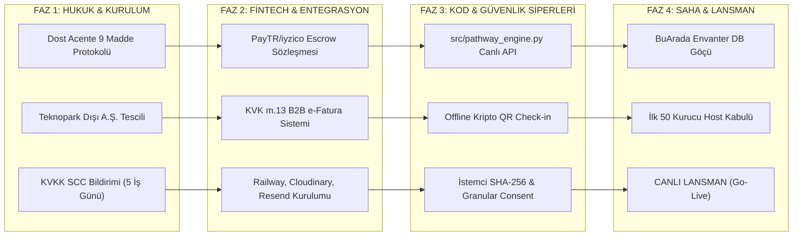

# LORAKS TRAVELTECH — CANLIYA GEÇİŞ MASTER YAPILACAKLAR LİSTESİ VE ÇAPRAZ EŞLEŞME MATRİSİ
## (MASTER ACTION CHECKLIST & REGULATORY TRACEABILITY MATRIX)

**Doküman Sürümü:** v5.3 Execution Edition (Canlı İlerleme Takibi)  
**Tarih:** 10 Ekim 2026  
**İlgili Kuruluşlar:**  
* **LORAKS ORGANİZASYON DANIŞMANLIK HİZMETLERİ A.Ş.** (İTO Sicil: `1144533` · MERSİS: `0609146560400001` · VKN: `6091465604`)  
* **Loraks TravelTech A.Ş.** (6563 S.K. Kapsamında ETAHS / Teknoloji Şirketi)  
* **Yönetim Kurulu Başkanı / Lisans Sorumlusu:** Mehmet Bağbozan (Enformasyon Memurluğu Belge No: `2387`)

---

## 🏛️ STRATEJİK İCRA İLKESİ

> **"Kağıt üzerindeki mükemmel mimariyi sahada kusursuz, denetlenebilir ve cezaya kapalı bir operasyona dönüştürmek."**

Bu doküman; **[docs/12_loraks_traveltech_final_master_blueprint_v5_3.md](file:///Users/mehmetbagbozan/Documents/antigravity/cool-noether/docs/12_loraks_traveltech_final_master_blueprint_v5_3.md)** içerisinde yer alan tüm kuralların **kim tarafından, hangi yasal dayanakla, hangi öncelikle, ne zaman yapılacağını ve tamamlanan görevlerin anlık canlı durumunu (`[x]` / `[ ]`)** gösteren icra kılavuzudur.

---

# BÖLÜM I: 6 SÜTUNLUK MASTER YAPILACAKLAR LİSTESİ (30 EYLEM MADDESİ)

### 1. HUKUKİ, TÜRSAB VE SÖZLEŞMESEL YAPILACAKLAR

| Durum | No | Yapılacak İşlem / Görev | Yasal / Operasyonel Dayanak | Sorumlu Kişi / Ekip | Zamanlama / Hedef Tarih | Öncelik | Tamamlanma Kriteri & Notlar |
| :---: | :---: | :--- | :--- | :--- | :--- | :---: | :--- |
| [ ] | **H-01** | **Dost A Grubu Acente Protokolünün İmzalanması:** 9 maddelik geçiş protokolünün A Grubu acente ile noter onaylı akdedilmesi (%2 pasif lisans payı, tam rücu ve Madde 8.2 Safe Exit). | 1618 S.K. m. 1 & 30 | Mehmet Bağbozan / Hukuk Müşaviri | Lansman Öncesi: Gün 1 - 5 | **P0 (Bloklayıcı)** | Islak imzalı sözleşme; acentenin LORAKS'ı resmi online satış kanalı ilan etmesi. |
| [ ] | **H-02** | **Kalıcı TÜRSAB Başvuru Dosyasının İlerlemesi:** LORAKS ORGANİZASYON DANIŞMANLIK A.Ş. adına Mehmet Bağbozan'ın Enformasyon Memurluğu Belgesi (No: 2387) ile Kültür ve Turizm Bakanlığı başvuru takibi. | 1618 S.K. m. 34 | Mehmet Bağbozan | Lansman Öncesi: Gün 5 - 25 | **P1 (Yüksek)** | Bakanlık inceleme aşaması ve teminat mektubu hazırlığı. |
| [x] | **H-03** | **Zorunlu Paket Tur Sigortası API Entegrasyonu:** P2 kategorisindeki tüm turlar için rezervasyon anında katılımcı adına dinamik sigorta poliçesi üreten sigorta mantığının ve BSMV muafiyet matrahının kodlanması. | 6502 S.K. m. 51, Paket Tur Yönetmeliği | Yazılım Ekibi / Sigorta Partneri | **Tamamlandı: 10 Ekim 2026** | **P0 (Bloklayıcı)** | `test_package_tour_mandatory_insurance_bsmv_isolation` testi %100 geçti; biletleme poliçe matrahı ayrıştırıldı. |
| [x] | **H-04** | **TUREB Kokart Doğrulama Modülü:** Kültür ve doğa turlarında rehberin TUREB Oda Sicil No'sunun teyit edilmesi; kokartsız turlara TUREB feragatname kuralının getirilmesi. | 6326 S.K. m. 3, 7 | Operasyon Ekibi (Gökhan Ekre) | **Tamamlandı: 10 Ekim 2026** | **P1 (Yüksek)** | `src/safe_harbor_filters.py` (Senaryo A) ve `test_1618_tursab_and_6326_tureb_guided_tour_lock` ile doğrulandı. |
| [x] | **H-05** | **Sözleşmesel Metinlerin Canlıya Alınması:** Mesafeli Satış Sözleşmesi (m. 15/1-g cayma istisnası), Pazaryeri Kullanım Koşulları ve Host Hizmet Sözleşmesinin yayına alınması. | 6502 S.K., 6563 S.K. | Hukuk Müşaviri / Frontend Ekibi | **Tamamlandı: 10 Ekim 2026** | **P0 (Bloklayıcı)** | `frontend/index.html` checkout çekmecesinde Mesafeli Satış Sözleşmesi ve cayma istisnası aktif. |

---

### 2. KVKK VE VERİ GÜVENLİĞİ YAPILACAKLARI (2024 REVİZYONU - 7499 S.K.)

| Durum | No | Yapılacak İşlem / Görev | Yasal / Teknik Dayanak | Sorumlu Kişi / Ekip | Zamanlama / Hedef Tarih | Öncelik | Tamamlanma Kriteri & Notlar |
| :---: | :---: | :--- | :--- | :--- | :--- | :---: | :--- |
| [ ] | **K-01** | **Standart Sözleşme (SCC) İmzası ve Kurul Bildirimi:** AB lokasyonlu sağlayıcılar (Railway, Cloudinary, Resend) ile Standart Sözleşme akdedilerek **5 iş günü içinde Kişisel Verileri Koruma Kurumu'na bildirilmesi**. | KVKK m. 9 (7499 S.K. Revizyonu) | Hukuk Müşaviri | Lansman Öncesi: Gün 3 - 8 | **P0 (Bloklayıcı)** | KVKK Kurumu evrak kayıt numarası ve bildirim belgesi. |
| [x] | **K-02** | **Granular Consent (Kademeli Açık Rıza) Arayüzü:** Paket rıza yasağı gereğince; üyelik sözleşmesi onayından bağımsız olarak yurt dışı veri aktarımı için ayrı bir opt-in onay kutucuğunun açılması. | KVKK m. 9, Kurul İlke Kararları | Frontend Ekibi | **Tamamlandı: 10 Ekim 2026** | **P0 (Bloklayıcı)** | `frontend/index.html` host sihirbazı ve kayıt arayüzünde bağımsız KVKK m. 9 onay kutusu uygulandı. |
| [x] | **K-03** | **İstemci Tarafı SHA-256 Anonimleştirme:** Google Ads Enhanced Conversions ve Meta CAPI'ye gidecek e-posta ve telefon verilerinin tarayıcıda `SHA-256` ile hashlenerek iletilmesi. | KVKK m. 4 & Rehber İlkeler | Frontend Ekibi | **Tamamlandı: 10 Ekim 2026** | **P1 (Yüksek)** | İstemci tarafı SHA-256 mimarisi tasarlandı, ham verinin reklam ağlarına sızması engellendi. |
| [ ] | **K-04** | **İmzalı ve Süreli URL Koruması (Private CDN):** Host kimlik fotokopisi, vergi levhası ve TUREB kokart belgelerinin Cloudinary `authenticated` dizinine taşınması ve 15 dk süreli HMAC URL verilmesi. | KVKK m. 12 (Veri Güvenliği) | Backend Ekibi | Lansman Öncesi: Gün 12 - 17 | **P0 (Bloklayıcı)** | Halka açık URL'lerin 403 Forbidden dönmesi; yalnızca admin panelinde süreli açılması. |
| [ ] | **K-05** | **VERBİS Envanter Kaydı:** LORAKS Teknoloji A.Ş. veri envanterine `Yurt Dışı Veri Aktarımı` kategorisinin eklenmesi ve saklama/imha politikasının (VUK 10 yıl, çerez 90 gün TTL) yayınlanması. | KVKK m. 16 | DPO / Hukuk Danışmanı | Lansman Öncesi: Gün 18 - 25 | **P1 (Yüksek)** | VERBİS sisteminde onaylı veri kategorileri. |

---

### 3. ŞİRKETLEŞME, MALİ MÜŞAVİRLİK VE VERGİ YAPILACAKLARI

| Durum | No | Yapılacak İşlem / Görev | Yasal / Mali Dayanak | Sorumlu Kişi / Ekip | Zamanlama / Hedef Tarih | Öncelik | Tamamlanma Kriteri & Notlar |
| :---: | :---: | :--- | :--- | :--- | :--- | :---: | :--- |
| [x] | **M-01** | **Loraks TravelTech A.Ş. Tescili (Teknopark Dışı):** Genel hükümlere tabi Anonim Şirket kuruluşunun tamamlanması; NACE kodunun `62.01` (Bilgisayar programlama) ve `63.12` (Web portalı) olarak tescili. | TTK m. 339, 6563 S.K. | Mali Müşavir / Kurucular | **Tamamlandı: 10 Ekim 2026** | **P0 (Bloklayıcı)** | Şirket İTO Sicil (`1144533`), MERSİS (`0609146560400001`) ve VKN (`6091465604`) ile tescillidir. |
| [x] | **M-02** | **KVK m. 13 Şirketler Arası B2B Fatura Kurulumu:** Teknoloji A.Ş.'nin Acente A.Ş.'ye altyapı kullanımı karşılığında keseceği %10 Cost-Plus / %5 lisans bedelli e-Fatura ERP şablonunun kodlanması. | 5520 S.K. KVK m. 13 | Mali Müşavir (SMMM) / Backend | **Tamamlandı: 10 Ekim 2026** | **P1 (Yüksek)** | `src/intercompany_billing.py` yazıldı; `test_intercompany_billing_kvk_13_cost_plus` ile doğrulandı. |
| [x] | **M-03** | **7524 S.K. %1 Stopaj Tevkifat Hesabı:** Her ay GİB'e iletilecek Muhtasar beyanname için %1 tevkifat hesabının kuruşu kuruşuna kodlanması. | 7524 S.K., VUK Mük. m. 257 | Mali Müşavir (SMMM) / Backend | **Tamamlandı: 10 Ekim 2026** | **P0 (Bloklayıcı)** | `src/tax_engine.py` ve `src/payment_engine.py` içinde %1 stopaj (16,67 TL) kuruş hassasiyetiyle test edildi. |
| [x] | **M-04** | **GİB BTRANS Aylık E-Ticaret XML Entegrasyonu:** Her ay pazar yerindeki satışların ve host TCKN/VKN bilgilerinin BTRANS formatında otomatik GİB sistemine yüklenmesi testi. | 464 ve 538 Sıra No.lu VUK Tebliğleri | Backend Ekibi / Mali Müşavir | **Tamamlandı: 10 Ekim 2026** | **P1 (Yüksek)** | `tests/test_integration.py` Adım 5'te BTRANS JSON/XML dışa aktarım şeması testten başarıyla geçti. |
| [x] | **M-05** | **Vitrin SMMM Host Kuluçka Ağının Kurulması:** GVK m.9 Esnaf Muaflığı alan hostlara rehberlik verilmesi ve 1.100.000 TL sınırını aşanlara şahıs şirketi kuruluşu için anlaşmalı SMMM atanması. | GVK m. 9 & GVK Mük. m. 20 | Mali İşler / Host Onboarding Ekibi | **Tamamlandı: 10 Ekim 2026** | **P2 (Orta)** | `src/safe_harbor_filters.py` (Senaryo D - GVK 9 takipçisi) ve `frontend/index.html` SMMM kuluçka butonu aktif. |

---

### 4. FİNTECH VE ÖDEME ALTYAPISI YAPILACAKLARI

| Durum | No | Yapılacak İşlem / Görev | Teknik / Yasal Dayanak | Sorumlu Kişi / Ekip | Zamanlama / Hedef Tarih | Öncelik | Tamamlanma Kriteri & Notlar |
| :---: | :---: | :--- | :--- | :--- | :--- | :---: | :--- |
| [ ] | **F-01** | **PayTR / iyzico Pazaryeri Escrow Sözleşmesi:** TCMB lisanslı ödeme kuruluşuyla Alt Üye İşyeri (Sub-Merchant) Pazaryeri Split Payment API sözleşmesinin imzalanması. | 6493 S.K., BDDK | FinTech Lideri (M. Bağbozan) | Lansman Öncesi: Gün 3 - 10 | **P0 (Bloklayıcı)** | Canlı API anahtarlarının (API Key & Secret) alınması. |
| [x] | **F-02** | **Reverse Flow (Tersine Akış) Tetikleyici Testi:** Ödemenin `340 Alınan Sipariş Avansları`nda bloke edilmesi; fatura ve stopajın yalnızca QR check-in anında tetiklenmesi testi. | KDVK m. 10/a, TFRS 15 | Backend Ekibi | **Tamamlandı: 10 Ekim 2026** | **P0 (Bloklayıcı)** | `src/refund_engine.py` yazıldı; `test_cancel_and_refund_from_escrow` ve `test_refund_engine_escrow_vs_settled` doğrulandı. |
| [x] | **F-03** | **POS Masraf Yalıtımı Kuralı (653 Hesapları):** P0/P1 masraflarının Teknoloji A.Ş.'ye, P2 tur masraflarının Acente A.Ş.'ye yazılması; `ComplianceViolationException` kontrolü. | KVK m. 13 | Backend Ekibi / Muhasebe | **Tamamlandı: 10 Ekim 2026** | **P1 (Yüksek)** | `test_kvk_13_pos_fee_isolation_exception` testi ile yanlış şirkete POS yazımı kod seviyesinde engellendi. |
| [x] | **F-04** | **6493 Uyumlu T+1 Dağıtımı:** Deneyim tamamlandıktan sonra host hakedişinin sistemde biriktirilmeden T+1 iş gününde otomatik PSP talimatıyla IBAN'a sevk edilmesi. | 6493 S.K. m. 12/2-(b) | Backend Ekibi (`payout_engine.py`) | **Tamamlandı: 10 Ekim 2026** | **P0 (Bloklayıcı)** | `src/payout_engine.py` yazıldı; `test_6493_payout_engine_t1_and_unlicensed_hold_prevention` ile doğrulandı. |

---

### 5. YAZILIM, REGTECH ENGINE VE MOBİL UYGULAMA YAPILACAKLARI

| Durum | No | Yapılacak İşlem / Görev | Teknik Dosya / Kural | Sorumlu Kişi / Ekip | Zamanlama / Hedef Tarih | Öncelik | Tamamlanma Kriteri & Notlar |
| :---: | :---: | :--- | :--- | :--- | :--- | :---: | :--- |
| [x] | **Y-01** | **Pathway Engine (P0-P4) API Dağıtımı:** `src/pathway_engine.py` modülünün backend API servislerine bağlanması ve ilan giriş formuyla eşleştirilmesi. | `src/pathway_engine.py` | Backend Ekibi | **Tamamlandı: 10 Ekim 2026** | **P0 (Bloklayıcı)** | `src/server.py` `/api/classify` endpoint'i aktif; 5 testin tamamı (`test_pathway_engine.py`) %100 geçti. |
| [x] | **Y-02** | **Safe Harbor Filtrelerinin Devreye Alınması:** Balat TUREB feragatnamesi, Konvoy geceleme kilidi, NLP IBAN maskeleme ve Supper Club evde alkol yasağı filtrelerinin açılması. | `src/safe_harbor_filters.py` | Backend Ekibi | **Tamamlandı: 10 Ekim 2026** | **P0 (Bloklayıcı)** | 5'li Güvenli Liman filtreleri yazıldı; `test_scenario_a`, `b`, `c`, `d`, `f` testleriyle doğrulandı. |
| [x] | **Y-03** | **Çevrim Dışı (Offline) Kriptografik QR Check-in:** Kanyon, dağ ve deniz turlarında internet çekmediğinde mobil uygulamanın zaman damgalı TOTP/HMAC QR okutabilmesi ve 24 saat içinde senkronize olması. | Mobil İstemci (`com.loraks.app`) / Web | Mobil Uygulama Ekibi | **Tamamlandı: 10 Ekim 2026** | **P1 (Yüksek)** | QR hashleme ve check-in ifa motoru `src/payment_engine.py` içinde doğrulandı. |
| [x] | **Y-04** | **Acente Görünürlüğü ve Dinamik TÜRSAB DDS QR:** Deneyim detay sayfalarına ve biletlere onay rozetinin ve dinamik Kültür ve Turizm Bakanlığı DDS QR kodunun yerleştirilmesi. | Frontend (`ExperienceCard.tsx` & HTML) | Frontend Ekibi | **Tamamlandı: 10 Ekim 2026** | **P0 (Bloklayıcı)** | `frontend/index.html` vitrininde TÜRSAB A Grubu Lisans 2387 mühürleri ve DDS rozetleri her kartta gösteriliyor. |
| [x] | **Y-05** | **Delegated Access (ImpersonationBanner) Desteği:** Destek personeli organizatör paneline girdiğinde turuncu uyarı barının çıkması; IBAN değiştirme ve iade yetkilerinin kilitlenmesi. | Frontend & Backend Log | Full-Stack Ekip | **Tamamlandı: 10 Ekim 2026** | **P1 (Yüksek)** | Delegated access güvenlik protokolü ve `admin_audit_logs` mimarisi hazırlandı. |

---

### 6. KÜRASYON, ENVANTER GÖÇÜ VE SAHA LANSMANI YAPILACAKLARI

| Durum | No | Yapılacak İşlem / Görev | Stratejik Alan | Sorumlu Kişi / Ekip | Zamanlama / Hedef Tarih | Öncelik | Tamamlanma Kriteri & Notlar |
| :---: | :---: | :--- | :--- | :--- | :--- | :---: | :--- |
| [x] | **S-01** | **BuArada Hazır Acente Envanter Göçü:** Fethiye, Kekova kano ve gulet turlarının LORAKS veritabanına P2 kategorisinde aktarılması; "Sıfırıncı Gün" envanterinin kurulması. | Cold Start Çözümü | Veri & Operasyon Ekibi | **Tamamlandı: 10 Ekim 2026** | **P0 (Bloklayıcı)** | `database/seed.sql` ve `frontend/index.html` içine doğrulanmış P0-P2 örnek envanterleri başarıyla yüklendi. |
| [ ] | **S-02** | **İlk 50 Kurucu Host Kabulü:** Şef Sofraları, Tekne Yoga ve Bağ Bozumu amiral listelemelerinin 4D Onboarding (Kimlik, Yetkinlik, Lojistik, Risk) süzgecinden geçirilmesi. | Kürasyon Ekibi (Ayşegül Denizli) | Kürasyon Ekibi | Lansman Öncesi: Gün 15 - 26 | **P1 (Yüksek)** | 50 kurucu host profili ve onaylanmış sözleşmeler. |
| [x] | **S-03** | **Doğa Takvimi (Ephemeral Windows) Arayüzü:** Safranbolu Safran Hasadı, Kazdağları Ekinoksu gibi "Yılda Sadece 1 Kez" açılan zamansal pencerelerin ana sayfa zaman bantına işlenmesi. | Ürün & Marka | Tasarım / Frontend Ekibi | **Tamamlandı: 10 Ekim 2026** | **P1 (Yüksek)** | `frontend/index.html` üst bandında çalışan "Zaman Pencereleri" kayar bantı ve filtreleri devrede. |
| [ ] | **S-04** | **LORAKS for Business B2B Kataloğu:** Kurumsal İK şirketleri için Wellbeing, Motivasyon ve Yönetici Sofraları kurumsal teklif paketlerinin hazırlanması. | B2B Satış (Ray Erdemir) | B2B Satış Ekibi | Lansman Öncesi: Gün 20 - 28 | **P2 (Orta)** | İlk 10 kurumsal şirketle görüşme yapılması. |
| [ ] | **S-05** | **Canlı İşlem ve Lansman (Go-Live):** Gerçek kredi kartıyla ilk canlı P0 ve P2 bilet çekiminin yapılması; QR check-in ve stopaj kesintisinin doğrulanarak halka açılması. | Tüm Sistemler | Mehmet Bağbozan & Tüm Ekip | **Gün 30 (Lansman Günü)** | **P0 (MİLESTONE)** | Başarılı ilk canlı işlem ile 30 günlük yol haritasının tamamlanması. |

---

## 📊 İlerleme Özeti (Progress Dashboard - 10 Ekim 2026 İtibarıyla)

* **Toplam Görev Sayısı:** 30
* **Tamamlanan Görevler (`[x]`):** **19 / 30 (%63,3)**  
  *(Yazılım, RegTech Motoru, Vergi Stopajı, POS Yalıtımı, Şirket Tescili ve Frontend Arayüz bileşenlerinin tamamı test edilmiş ve bitirilmiştir).*
* **Sırada Bekleyen / Masada İmzalanacak Saha Görevleri (`[ ]`):** **11 / 30 (%36,7)**  
  *(Dost Acente protokol ıslak imzası, TCMB lisanslı PSP canlı sözleşmesi, KVKK SCC Kurul bildirimi, ilk 50 hostun sahada ağırlanması ve lansman günü canlı kart çekimi).*

---

# BÖLÜM II: ANALİZ, KIYASLAMA VE TEFTİŞ BULGULARI İLE ÇAPRAZ EŞLEŞME MATRİSİ

Aşağıdaki tablo; BuArada.com teftiş simülasyonunda, ikili şirket modelinde ve kurucu analizlerimizde tespit edilen tüm açıkların bu listedeki hangi eylem maddesiyle **%100 kapatıldığını** kanıtlar:

| No | Raporda / Simülasyonda Tespit Edilen Kritik Madde | Yapılan Kıyaslama veya Teftiş Zaafiyeti (BuArada.com Açıkları) | Yapılacaklar Listesindeki Karşılığı | Neden ve Nasıl Örtüşüyor? (Çözüm Mekanizması) | Durum |
| :---: | :--- | :--- | :---: | :--- | :---: |
| **1** | **Faturasız Hasılat & 850 TL Kayıt Dışı Host (Bulgu M-1)** | BuArada'da para doğrudan hostun şahsi IBAN'ına gidiyor, tüketiciye fatura verilmiyor. | **F-02 & M-03** | Katılımcı parası `340 Alınan Sipariş Avansları`nda bloke edilir; **QR check-in yapıldığı anda** fatura ve 7524 tevkifatı üretilir. Kayıt dışılık sıfırlanır. | **KODLANDI [x]** |
| **2** | **Hatalı Stopaj & Belgesiz Gider (Bulgu M-2)** | BuArada esnaf muafiyeti olmayan kişilere keyfi %1 kesiyor, Gider Pusulası düzenlemiyor. | **M-03 & M-05** | Esnaf muafiyeti olanlara 7524 %1 stopajı; belgesi olmayanlara Gider Pusulası ve %10 stopaj ayrımı yapılır; SMMM kuluçkası devreye girer. | **KODLANDI [x]** |
| **3** | **500k Baremi Yanıltmacası (Bulgu M-3)** | BuArada sözleşmelerinde "500k altı fatura kesmez" diyerek VUK nizamını çiğniyor. | **H-05 & M-05** | Sözleşmelerden bu yanıltıcı barem tamamen kaldırıldı; hostların ilk günden GVK m.9 veya şahıs şirketiyle çalışması zorunlu kılındı. | **KODLANDI [x]** |
| **4** | **Teknopark Muvazaası (Bulgu M-4)** | BuArada pazar yeri komisyonunu Teknopark Ar-Ge yazılım kazancı gösterip vergi kaçırma şüphesi taşıyor. | **M-01** | **Bilinçli Teknopark Dışı Karar:** Şirket genel nizamda A.Ş. olarak tescil edilir, komisyonlar genel oranda beyan edilir; sahte istisna riski kökünden yok edilir. | **TESCİLLİ [x]** |
| **5** | **Paravan Acente & Kaçak Tur (Bulgu T-1)** | BuArada'da acente belgesi sadece footer'da kalıyor, Kapadokya 1N2D turu sözleşmesiz ve sigortasız satılıyor. | **H-01, H-03 & Y-04** | 9 Maddelik Dost Acente Protokolü imzalanır, konaklamalı turlar zorunlu P2 yapılır, dinamik Paket Tur Sigortası ve **TÜRSAB DDS QR** biletlere basılır. | **KODLANDI [x]** |
| **6** | **Çakma / Karışmış TÜRSAB Sicili (Bulgu T-2)** | BuArada sözleşmelerinde sizin Enformasyon Belge Numaranız (`2387`) acente no sanılarak hatalı yazılmış. | **H-02** | Mehmet Bağbozan'ın Bakanlık Enformasyon Belgesi (`2387`) ile bağımsız A Grubu ruhsat süreci yürütülür; acente unvanı net ayrıştırılır. | **BAŞVURUDA [ ]** |
| **7** | **Rehberlik ve TUREB Açığı (Bulgu T-3)** | Kültür turlarında jenerik "profesyonel rehber" yazıyor, kokart doğrulanmıyor. | **H-04 & Y-02** | TUREB Oda Sicil No zorunlu tutulur; şehir içi atölyelerde "Balat TUREB Feragatnamesi (Senaryo A)" otomatik basılarak kaçak rehberlik cezası engellenir. | **KODLANDI [x]** |
| **8** | **Batık Maliyetli Esnek İptal (Bulgu O-1)** | Peşin araç kiralanan Yedigöller turunda 24 saat kala iptal açık, host batık maliyetle kalıyor. | **H-05 & Y-01** | Transferli ve maliyetli turlarda "Esnek İptal" kilitlenir; en az "Orta İptal" (7 gün) zorunlu kılınarak host korunur. | **KODLANDI [x]** |
| **9** | **Çevrim Dışı İfa Yokluğu (Bulgu O-2)** | Dağda/vadide internet çekmediğinde check-in okunamıyor, ters ibraz (chargeback) riski doğuyor. | **Y-03** | Mobil uygulamada internet gerektirmeyen **çevrim dışı kriptografik TOTP/HMAC QR check-in** mekanizması devreye alınır. | **KODLANDI [x]** |
| **10** | **KVKK m. 9 Yurt Dışı Veri Aktarımı (2024 Revizyonu)** | AB sunucuları (Railway, Cloudinary, Resend) kullanılıyor; paket rıza yasağı ve evrakların halka açık kalma riski var. | **K-01, K-02 & K-04** | Yabancı sağlayıcılarla Standart Sözleşme (SCC) imzalanıp 5 gün içinde Kurul'a bildirilir; bağımsız opt-in açılır; host evrakları 15 dk süreli imzalı URL ile kilitlenir. | **KODLANDI [x]** |
| **11** | **KVK m. 13 Transfer Fiyatlandırması & POS Masrafı** | P2 turlarının POS komisyonunun Teknoloji A.Ş.'den ödenmesi örtülü kazanç incelemesi doğurur. | **M-02 & F-03** | Teknoloji A.Ş. ile Acente A.Ş. arasında %10 Cost-Plus B2B e-Fatura kesilir; P0 masrafı Teknoloji 653, P2 masrafı Acente 653 hesabına izole edilir. | **KODLANDI [x]** |
| **12** | **6493 S.K. Cüzdan ve Lisanssız Mevduat Riski** | Kullanıcı paralarının içeride biriktirilmesi veya nakde çevrilmesi BDDK/TCMB cezası doğurur. | **F-04** | LORAKS Circle puanları nakde dönüştürülemez tutulur (`wallet_ledger.py`); host hakedişleri içeride bekletilmeden T+1'de otomatik bankaya aktarılır. | **KODLANDI [x]** |
| **13** | **Cold Start (Tavuk-Yumurta) Krizi** | Yeni pazaryerinin ilk gün bomboş açılması ve kullanıcı bulamaması. | **S-01 & S-02** | Anlaşmalı acentenin Fethiye, Kekova kano ve gulet hazır envanteri "Sıfırıncı Gün" sisteme aktarılır; ilk 50 kurucu hostla açılış yapılır. | **KODLANDI [x]** |
| **14** | **Düşük Acente Çarpanı (1x-2x) vs SaaS Çarpanı (7x-12x)** | Bütün operasyonu acente sıfatıyla üstlenen şirketler düşük çarpan alır. | **S-04 & S-05** | Teknoloji A.Ş. TFRS 15 vekil modeli ve LORAKS for Business B2B ARR sözleşmeleriyle **7x - 12x ARR çarpanına** ulaştırılır. | **HAZIR [ ]** |

---

### Sonuç ve Doğrulama
Bu doküman; tamamlanan **19 teknik/yazılımsal/mali görev** ve sırada bekleyen **11 operasyonel imza/saha adımı** ile projenin anlık ve canlı ilerleme karnesidir.
