# LORAKS TRAVELTECH — SÜRÜM EVRİM GÜNLÜĞÜ VE MASTER BLUEPRINT EKSİKLİK/ÇELİŞKİ ANALİZİ
## (CHRONOLOGICAL VERSION EVOLUTION & GAP/CONFLICT AUDIT REPORT)

**Tarih:** 10 Ekim 2026  
**İncelenen Kapsam:** 17 Kaynak Belge, NotebookLM Arşivi, v2.0'dan v5.3'e Kadar Tüm Taslaklar ve Test Edilmiş Kod Tabanı  
**Hazırlayan:** Antigravity AI Mimarlık Ofisi  
**Muhatap:** Mehmet Bağbozan (Yönetim Kurulu Başkanı & Lisans Sorumlusu)

---

## 🏛️ BÖLÜM 1: KRONOLOJİK SÜRÜM EVRİMİ (v2.0 ➔ v5.4)

LORAKS projesi; romantik bir mahalle buluşması fikrinden başlayıp, ağır mevzuat gerçekleriyle yüzleşerek nihayetinde savunulabilir, kurumsal ve yüksek çarpanlı bir küresel TravelTech mimarisine evrilmiştir.

```mermaid
flowchart TD
    V2["v2.0 (İlk Taslaklar): 'EtkinlikSepeti' & Tek Şirket<br/>• Romantik atölyeler, tarot geceleri, kontrolsüz nakit<br/>• 'Sepet' çağrışımı, TTK 159 Bölünme düşüncesi<br/>• RİSK: 1618 S.K. Kaçak Tur ve Ağır Cezalar"]
    
    V5_0["v5.0: Sahanın Soğuk Gerçekleri & İkili Model Fikri<br/>• BuArada.com incelemesi ve 1618 tehlikesinin keşfi<br/>• Teknoloji A.Ş. + Seyahat Acentesi ayrımı doğdu<br/>• %15 komisyon ve IFRS 15 Agent modeli tasarlandı"]
    
    V5_1["v5.1: Evrensel Deneyim Pazaryeri ve Bilinçli Düzeltmeler<br/>• 'Kayıt dışını rehabilite eden regülasyon projesi' algısı yıkıldı<br/>• TTK 159 kısmi bölünme 3 yıl müteselsil borç doğurduğu için REDDEDİLDİ<br/>• Bağımsız kardeş şirket modeli ve Dost Acente kalkanı benimsendi<br/>• 2.000 TL birim iktisat: 300 TL Komisyon, 16.67 TL Stopaj, 1.683.33 TL Net"]
    
    V5_2["v5.2: Safe Harbor Koruma Siperleri & Kod Motoru<br/>• 5'li Güvenli Liman filtreleri (TUREB 6326, Kamp P2, Chat, GVK 9, Alkol)<br/>• Python float kuruş sapması engellendi (Decimal motoruna geçildi)<br/>• 6493 uyumlu LORAKS Circle Sadakat Cüzdanı kodlandı"]
    
    V5_3["v5.3: Production Gold Edition & 30 Testlik Doğrulama<br/>• Resmi denetim simülasyonu (M-1 - M-4, T-1 - T-3)<br/>• Teknopark muvazaası bilinçli olarak reddedildi (Genel Nizam A.Ş.)<br/>• 30/30 test süiti %100 yeşil doğrulandı"]
    
    V5_4["v5.4 (NİHAİ BİRLEŞİK HEDEF): The Unified Definitive Master Edition<br/>• v5.3'te unutulan Creator Academy & Rehber Gig-Board eklendi<br/>• Host OS 4 B2B Yan Gelir Modeli ve SMMM kuluçkası entegre edildi<br/>• Parametrik Hava Durumu, BNPL ve Creator Avansı eklendi<br/>• B2B ESG Karbon Muhasebesi ve Kamu Pasaportu bağlandı<br/>• KVKK 2024 SCC 5 günlük bildirim protokolü tam metinleşti<br/>• TEK GERÇEK KAYNAK (SINGLE SOURCE OF TRUTH) TAMAMLANDI"]

    V2 --> V5_0
    V5_0 --> V5_1
    V5_1 --> V5_2
    V5_2 --> V5_3
    V5_3 --> V5_4
```

---

## 🔍 BÖLÜM 2: MASTER BLUEPRINT v5.3'TE UNUTULAN / EKSİK BIRAKILAN 15 KRİTİK MODÜL

Mevcut `docs/12_loraks_traveltech_final_master_blueprint_v5_3.md` belgesi incelendiğinde; önceki stratejik araştırma belgelerinizde (özellikle docs/03, docs/06, docs/11, docs/14) çok detaylı kurgulandığı halde, nihai metne **aktarılmamış veya yüzeysel geçilmiş** şu hayati modüller saptanmıştır:

| # | Unutulan / Eksik Kalan Modül | Hangi Belgede Vardı? | Neden v5.3'te Eksikti ve Neden Hayati? | Çözüm / v5.4'e Eklenecek Bölüm |
| :---: | :--- | :--- | :--- | :--- |
| **1** | **LORAKS Creator Academy & Up-skilling Müfredatı** | `docs/11` (Bölüm 2 & 3) | v5.3 sadece biletlemeye odaklandı; üreticilerin eğitilmesi, sertifikasyonu ve içerik kalitesini artıran 4 aşamalı akademi modülü unutuldu. | **Bölüm 8:** Creator Academy & Yetkinleştirme Motoru |
| **2** | **'Loraks Certified' ve 'Corporate Preferred' Rozet Algoritması** | `docs/11` (Bölüm 2.1) | Dönüşüm oranını %15-%30 artıran, onaylı üreticilere verilen prestij rozeti motoru v5.3'te kodlanmamıştı. | **Bölüm 8:** Rozet ve Prestij Motoru |
| **3** | **TUREB Kokartlı Rehber Gig-Board (Esnek İstihdam)** | `docs/11` (Bölüm 2.3) | Kokartlı rehberlerin niş rotalara gig bazlı bağlanması ve rota denetimi yapması modeli v5.3'te sadece yasak boyutuyla kaldı, pazar yeri modeli eksikti. | **Bölüm 9:** TUREB Rehber Ağı & Gig-Board |
| **4** | **Host OS: 4 B2B Yan Gelir Akışı (Ancillary Revenues)** | `docs/06` (Bölüm 2) | SMMM yönlendirme primi (1.500-3.000 TL), 1 Günde Yasal Başlangıç paketi (3.900 TL), e-Fatura bayi payı (%25) ve Genç Girişimci/KOSGEB danışmanlığı v5.3'te yer almadı. | **Bölüm 10:** Host OS & B2B Yan Gelir Motoru |
| **5** | **Host Hak Edişinin Kutsallığı Kuralı (Anti-Hidden Fee)** | `docs/06` (Bölüm 2 Notu) | Host'un 1.683,33 TL'lik bilet gelirine asla ek komisyon dokunulmayacağı; yan gelirlerin SaaS firmaları ve SMMM'lerin kendi ceplerinden verileceği ilkesi vurgulanmamıştı. | **Bölüm 10:** Host Geliri Koruma Kuralı |
| **6** | **Parametrik Mikro-Sigorta (Weather Guarantee API)** | `docs/03` (Bölüm 1.1) | Sensible Weather emsali; yağmur/fırtınada beyansız anında iade sağlayan ve platforma %3.5 ek kâr bırakan checkout güvencesi v5.3'te yoktu. | **Bölüm 11:** FinTech & InsurTech Enstrümanları |
| **7** | **BNPL (Şimdi Al Sonra Öde) & Taksitli Satış Altyapısı** | `docs/03` (Bölüm 1.2) | 7.500 - 35.000 TL'lik pahalı inziva/kamp turlarında sepet terkini %30 azaltan Klarna/Uplift benzeri yerel taksit entegrasyonu v5.3'te yoktu. | **Bölüm 11:** BNPL & Alışveriş Kredisi Modülü |
| **8** | **Creator Finance & Gelir Teminatlı Avans (RBF)** | `docs/03` (Bölüm 1.3) | Stripe Capital / Shopify Capital benzeri; güvenilir üreticilere fırın/malzeme alımı için 10.000-50.000 TL hazırlık avansı verilip biletlerden %20 kesilmesi modeli eksikti. | **Bölüm 11:** Creator Finance & Avans Motoru |
| **9** | **B2B Kurumsal ESG & GSTC Kapsam 3 Karbon Raporlaması** | `docs/03` (Bölüm 2.1) | Şirketlerin kurumsal İK etkinliklerinde AB CSRD uyumlu karbon ayak izi faturası kesilmesi (Thrust Carbon modeli) v5.3'te atlanmıştı. | **Bölüm 12:** LORAKS for Business & ESG Katmanı |
| **10** | **Kamu & Smart City Ortaklığı (Bandwango Modeli)** | `docs/03` (Bölüm 4) | Belediyelerin "Deneyim Pasaportu" ve Yerel Kadın Kooperatifleri ittifakı v5.3'e dahil edilmemişti. | **Bölüm 13:** Kamu & Kooperatif Ekosistemi |
| **11** | **KVKK 2024 Revizyonu: Standart Sözleşme (SCC) 5 Gün Kuralı** | `docs/14` (Bölüm 3.1) | 7499 sayılı Kanun gereği AB sunucularıyla imzalanan SCC'nin 5 iş günü içinde Kurul'a bildirilmesi zorunluluğu v5.3'te yoktu. | **Bölüm 14:** KVKK m.9 & Veri Güvenliği Protokolü |
| **12** | **15 Dakika Süreli HMAC İmzalı Özel URL Koruması** | `docs/14` (Bölüm 3.1) | Host kimlik ve vergi belgelerinin yabancı CDN'de (Cloudinary) halka açık kalmaması için 15 dk süreli imzalı URL kuralı v5.3'te yer almadı. | **Bölüm 14:** Medya Güvenliği & Private CDN |
| **13** | **Destek Paneli Delegated Access (Emanet Yetki) Kalkanı** | `docs/14` (Bölüm 3.4) | Destek personelinin şifresiz, 30 dk süreli, IBAN değiştirme ve silme yetkisi kilitli oturum açma mimarisi v5.3'te eksikti. | **Bölüm 15:** Delegated Access & Audit Mimarisi |
| **14** | **Dost Acente 9 Maddelik Protokolünün Madde Madde Açılımı** | `docs/14` (Bölüm 1.3) | v5.3'te protokol sadece özetlenmiş; Madde 3, 5, 6, 8.2 ve 9'un tam metinleri açıkça işlenmemişti. | **Bölüm 2:** 9 Maddelik Protokol Sözleşme Metni |
| **15** | **Bakanlık #2387 Lisansının Net Sicil Ayrımı** | `docs/13` & `docs/05` | BuArada.com'un yaptığı gibi Enformasyon Belgesi ile A Grubu Acente Belgesinin birbirine karışmasını önleyen resmi ayrım tam netleştirilmemişti. | **Bölüm 2:** Lisans & Sorumlu Müdürlük Ayrımı |

---

## ⚠️ BÖLÜM 3: TESPİT EDİLEN KAVRAMSAL ÇELİŞKİLER VE DÜZELTMELER (CONFLICT AUDIT)

1. **TTK m. 159 Kısmi Bölünme vs Bağımsız Kardeş Şirket:**
   * *Çelişki:* Erken dönem notlarında (v2.0 / Part 3) "Acente işini şirketten kısmi bölünmeyle ayıralım" denilmişti.
   * *Kesin Karar:* TTK m. 173 ve m. 178 uyarınca kısmi bölünme **3 yıl boyunca ana ve yavru şirkete müteselsil borç sorumluluğu** yükler. Seyahat kazası teknoloji şirketini batırabilir. Bu yüzden **kısmi bölünme tamamen terk edilmiş**, sıfırdan **bağımsız kardeş şirket (Loraks TravelTech A.Ş.)** kurulması karara bağlanmıştır.
2. **"EtkinlikSepeti" İsim Yanılgısı:**
   * *Çelişki:* İlk taslaklarda "EtkinlikSepeti" ismi geçmişti.
   * *Kesin Karar:* "Sepet" kelimesi 2026 dünyasında indirimli, kalitesiz komisyonculuk çağrışımı yapar. İsim kesin olarak **LORAKS**'tır. Motto: *"Bir araya gelmenin değerini bilenler için."*
3. **Teknopark Muafiyeti Tuzağı:**
   * *Çelişki:* BuArada.com gibi Eskişehir Teknopark'a girip vergiden kaçınma fikri tartışılmıştı.
   * *Kesin Karar:* Pazar yeri komisyonlarını Teknopark Ar-Ge kazancı göstermek (4691 S.K. muvazaası) ağır bir vergi ziyaı suçudur. **LORAKS Teknopark dışında genel nizamda Anonim Şirket olarak kurulur**, şeffaf vergilendirilir.
4. **Host Hak Edişinden İlave Kesinti Yanılgısı:**
   * *Çelişki:* Yan gelirler tartışılırken hostun hak edişinden %20 kesileceği gibi bir yanlış anlama doğmuştu.
   * *Kesin Karar:* **Hostun 1.683,33 TL hak edişine asla dokunulmaz.** B2B primleri üçüncü taraf SaaS yazılımları (Paraşüt vb.) ve SMMM ofisleri kendi standart fiyatlarından LORAKS'a yönlendirme payı olarak verir.
