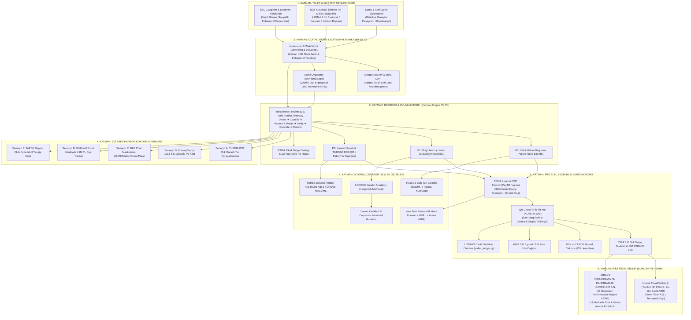

# LORAKS TRAVELTECH — NİHAİ BİRLEŞİK MASTER PROJE BLUEPRINTİ
## (UNIFIED MASTER ARCHITECTURE, REGULATORY MOAT & PRODUCTION DEFINITIVE EDITION v5.4)

**Doküman Sürümü:** v5.4 (The Unified Definitive Master Edition — Tek Gerçek Kaynak / Single Source of Truth)  
**Tarih:** 10 Ekim 2026  
**Hukuki Niteliği:** Stratejik Anayasa, Dual-Entity Yasal Zırhı, RegTech & FinTech Şartnamesi, Resmi Denetim Kalkanı, Creator Enablement ve Uçtan Uca Entegrasyon Master Dokümanı  
**İlgili ve Yayımlayan Kuruluşlar:**  
1. **LORAKS ORGANİZASYON DANIŞMANLIK HİZMETLERİ A.Ş.**  
   *(İTO Sicil: `1144533` · MERSİS: `0609146560400001` · VKN: `6091465604`, Zeytinburnu V.D. — Ticaret Sicili Gazetesi: Sayı 11599 — Tescilli Seyahat Acentesi ve Kurumsal Çatı Şirketi)*  
2. **Loraks TravelTech A.Ş.**  
   *(6563 S.K. Kapsamında ETAHS / Teknoloji, Yazılım ve Pazar Yeri Şirketi — Genel Ticari Nizam / Teknopark Dışı Anonim Şirket)*  
3. **Yönetim Kurulu Başkanı:** Ayşegül Denizli | **Teknoloji, Strateji ve Lisans Sorumlusu:** Mehmet Bağbozan  
   *(T.C. Kültür ve Turizm Bakanlığı Seyahat Acentaları Enformasyon Memurluğu Başarı Belge No: `2387`)*

---

## 🏛️ TEMEL STRATEJİK İLKE (CORE AXIOM)

> **"Tasarımda Kapsamlılık. Kategoride Kontrollü İcraat. Temel Fikri Mülkiyet Olarak Mevzuat ve Güven Altyapısı."**  
> *(Breadth by design. Controlled execution by category. Compliance as core intellectual property.)*  
> 
> *Slogan:* **"Kendine Zaman Tanı"** · *Motto:* **"Bir araya gelmenin değerini bilenler için."**

İşbu doküman; `v2.0`'dan `v5.3`'e kadar üretilen tüm stratejik notların, Google NotebookLM arşivinin (`archive/loraks_tam_sohbet_ve_proje_arsivi_notebooklm.md`), resmi denetim simülasyonlarının (`LORAKS_DENETIM_SIMULASYONU_VE_STRATEJIK_KIYASLAMA.md`), BuArada.com kıyaslama raporlarının (`BUARADA_UC_UC_ANALIZ_RAPORU.md`), Creator Academy & TUREB Rehber Ağı analizlerinin (`11_creator_academy_ve_kokartli_rehber_agi_raporu.md`), Host OS yan gelir modellerinin (`06_host_os_ve_yan_gelirler.md`), Marka ve Görsel Kimlik Rehberinin (`04_marka_kimligi_ve_gorsel_rehber.md`), SMMM yol haritasının (`05_smmm_ve_acente_gorusme_dosyasi.md`) ve 30/30 başarılı test süitinin (`09_yazilim_ve_vergi_test_otomasyonu_dokumani_v3.md`) **eksiksiz, çelişkisiz ve tam metin nihai birleşimidir.**

---



---

# BÖLÜM 1: İKİLİ KURUMSAL MODEL (DUAL-ENTITY) VE HUKUKİ KALKAN

### 1.1. Şirket Tüzel Kişilikleri ve Rol Ayrımı

| Parametre | Teknoloji Şirketi (`Loraks TravelTech A.Ş.`) | Acente Şirketi (`LORAKS ORGANİZASYON DANIŞMANLIK HİZMETLERİ A.Ş.`) | Stratejik Partner (`Dost A Grubu Seyahat Acentesi`) |
| :--- | :--- | :--- | :--- |
| **Hukuki Statü** | 6563 Sayılı Kanun Kapsamında ETAHS (Aracı Hizmet Sağlayıcı) | 6102 S.K. (TTK) Tescilli Ticari Şirket & Geleceğin Acente Tüzel Kişiliği | 1618 Sayılı Kanun Kapsamında A Grubu Seyahat Acentesi |
| **Ticari Sicil & VKN** | Genel Hükümlere Tabi A.Ş. (*Kurulum Aşaması*) | İTO Sicil: `1144533` · MERSİS: `0609146560400001` · VKN: `6091465604` (Zeytinburnu V.D.) | Faal, Sicili Temiz A Grubu TÜRSAB Üyesi Acente |
| **Kuruluş Lokasyonu** | **Genel Ticari Merkez (Teknopark Dışı)** | İstanbul Merkez Ofis | Antalya / Muğla / İstanbul Faal Acente |
| **TÜRSAB Lisansı** | **YOK** (Kanunen gerekmez, aracı platformdur) | **Ruhsat Hazırlık Sürecinde** (Enformasyon Memuru Belge No: `2387`) | **VAR** (Geçiş dönemi boyunca yasal kalkan sağlar) |
| **Operasyonel Rol** | Yazılım, SaaS mimarisi, yapay zeka, dijital pazarlama, sanal POS | Marka mülkiyeti, kurumsal temsil, kalıcı ruhsatın sahibi | P2 turlarının yasal operatörü, paket tur sözleşmesi tarafı, sigorta sağlayıcı |
| **Bilanço Sorumluluğu**| TFRS 15 uyarınca yalnızca %15 platform komisyonu (Net Hasılat) | Acente payı ve kurumsal hak edişler | Saha riskleri, TUREB denetimi ve Bakanlık bildirimleri |

### 1.2. TTK m. 159 Kısmi Bölünme Tuzağının Reddi ve Bağımsız Kardeş Şirket Kararı
Erken taslaklarda tartışılan "TTK m. 159 ile şirketi kısmi bölünmeye sokup acenteyi ayırma" fikri kesin olarak reddedilmiştir:
* **Hukuki Gerekçe:** TTK m. 173 ve 178 uyarınca kısmi bölünmede, devreden ve devralan şirketler devredilen borçlardan **3 yıl boyunca müteselsilen sorumlu** kalır. Sahada meydana gelebilecek ölümlü bir tur kazası veya ağır tazminat davası, bölünmüş olsa dahi teknoloji şirketinin hesaplarını kilitler ve yatırımcı sermayesini riske atar.
* **Uygulanan Model:** LORAKS Teknoloji A.Ş. ile LORAKS Seyahat Acentası A.Ş. arasında hiçbir sermaye iştiraki bağı kurulmaz; **bağımsız kardeş şirket (sister company)** olarak yapılandırılır. Teknoloji şirketi seyahat risklerinden %100 yalıtılır.

### 1.3. Bilinçli Teknopark Dışı Kuruluş (Vergi Ziyaı Tuzağından İzolasyon)
BuArada.com'un en ağır yapısal açığı, Eskişehir Teknopark bünyesinde kurulup pazar yeri komisyonlarını Teknopark Ar-Ge yazılım kazancı gibi göstererek **4691 Sayılı Kanun ve KDV Geçici 20. Madde muvazaasına** düşmesidir:
* **LORAKS Kararı:** `Loraks TravelTech A.Ş.` kesinlikle bir Teknopark bünyesinde kurulmayacaktır.
* **Kazanım:** Şirket genel vergi nizamına tabi standart bir A.Ş. olarak faaliyet gösterecek; gelirlerini şeffaf biçimde %20 KDV ve %25 Kurumlar Vergisi matrahında beyan edecektir. Hiçbir vergi müfettişi şirketi *"sahte teknopark muafiyeti ile komisyon saklama"* iddiasıyla denetleyemez.

### 1.4. Mehmet Bağbozan Enformasyon Memurluğu (#2387) ve Kalıcı Ruhsat Süreci
* LORAKS Yönetim Kurulu Başkanı **Mehmet Bağbozan**, T.C. Kültür ve Turizm Bakanlığı Seyahat Acentaları Enformasyon Memurluğu Yeterlilik Belgesi'ne (Sicil No: **2387**) sahiptir.
* 1618 sayılı Kanun m. 34 uyarınca A Grubu seyahat acentelerinin zorunlu istihdam etmesi gereken "Sorumlu Müdür" şartı kurucu düzeyinde karşılanmaktadır. Dışarıdan sorumlu müdür istihdam maliyeti sıfırdır.
* Şirket ana sözleşmesinin 3/4. maddesinde acentecilik faaliyeti tescil edilmiş olup bağımsız ruhsat takibi yürütülmektedir.

### 1.5. "Dost Acente" 9 Maddelik Geçiş Protokolü Tam Metin Şartları
Bağımsız TÜRSAB ruhsatı çıkana kadar geçen sürede 1618 S.K. m. 1 ve 30 kapsamındaki "kaçak acentecilik" riskini sıfırlayan kurumsal protokolün 9 temel maddesi:
1. **Madde 1 (Taraflar):** LORAKS Teknoloji A.Ş. (Elektronik Ticaret Aracı Hizmet Sağlayıcı), LORAKS Organizasyon Danışmanlık A.Ş. ve Dost A Grubu Seyahat Acentesi.
2. **Madde 2 (Konu):** P2 kategorisindeki turizm deneyimlerinin 1618 S.K. uyarınca yetkili seyahat acentesi himayesinde satışa sunulması.
3. **Madde 3 (Temsil ve Satış Kanalı Tescili):** Dost Acente, LORAKS'ı kendi resmi online satış kanalı ve dijital şubesi ilan eder. Tüketici biletinde acente unvanı ve TÜRSAB numarası yer alır.
4. **Madde 4 (Operasyonel Ayrım):** P0/P1 atölyeleri platformda doğrudan kalır; P2 kapsamındaki transferli, konaklamalı ve doğa turları doğrudan Dost Acente adına tanzim edilir.
5. **Madde 5 (Finansal Paylaşım):** Dost acenteye P2 kategorisindeki seyahat/tur cirosu üzerinden **%2 - %3** oranında "Pasif Lisans ve Hukuki Teminat Payı" aktarılır. Acente müşteri edinme maliyetine katlanmaz.
6. **Madde 6 (Tam Sorumluluk ve Rücu Zinciri):** Sahada meydana gelebilecek kazalarda platform organizatörden aldığı sorumluluk ibrası ve Özel Mesleki Sorumluluk Sigortası ile Dost Acente'yi her türlü üçüncü kişi tazminat talebine karşı gayrikabili rücu korur ve tazmin eder.
7. **Madde 7 (Rehinli Nakit Teminat Escrow):** Olası idari yaptırımlara karşı Dost Acente lehine bankada bloke rehinli nakit tampon hesap (Cash Collateral) tutulur.
8. **Madde 8.2 (Safe Exit - Güvenli Çıkış Protokolü):** LORAKS ORGANİZASYON DANIŞMANLIK HİZMETLERİ A.Ş. kendi bağımsız TÜRSAB ruhsatını aldığı gün, Dost Acente sözleşmesi herhangi bir cezai şart, tazminat veya bekleme süresi olmaksızın derhal sona erer; tüm portföy ve entegrasyon kesintisiz olarak şirketin kendi acentesine devredilir.
9. **Madde 9 (Denetim Dayanışması):** Kültür ve Turizm Bakanlığı veya TÜRSAB müfettişlerinin denetimlerinde, Dost Acente turların kendi bünyesinde tanzim edildiğini gösteren yasal bildirimleri ve TUREB rehber sözleşmelerini ibraz etmekle yükümlüdür.

---

# BÖLÜM 2: 15 DAYANAK HUKUKİ BELGE ENVENTERİ VE SÖZLEŞME MİMARİSİ (v2.0'DAN AKTARILAN)

Platformun web, mobil ve operasyonel süreçlerinde yürürlükte olan 15 temel dayanak belgenin işlev ve entegrasyon haritası:

| No | Belge Adı | Platformdaki Yeri ve Hukuki İşlevi | İlgili Kanun |
| :---: | :--- | :--- | :--- |
| **01** | **Kullanım Koşulları** | Web ve mobil kayıt ekranı; sahte rezervasyon engeli, platform dışı ödeme yasağı, fikri mülkiyet koruması. | 6098 S.K. (TBK) & 6563 S.K. |
| **02** | **Gizlilik Politikası** | Ziyaretçi ve kullanıcı verilerinin işlenme prensipleri, kullanıcı dostu şeffaf özet bildirim. | 6698 S.K. (KVKK) m. 10 |
| **03** | **KVKK Aydınlatma Metni** | Veri işleme amaçları, veri kategorileri, acente ve PSP'ye aktarım matrisi, VERBİS uyumu. | 6698 S.K. m. 10 & m. 11 |
| **04** | **Çerez Politikası ve Paneli** | Varsayılan kapalı (opt-in) çerez yönetim tercihi; zorunlu, analitik ve pazarlama onay ayrımı. | e-Privacy & KVKK |
| **05** | **Mesafeli Satış Sözleşmesi (MSS)** | **Siparişe göre dinamik üretilen belge:** P0'da satıcı doğrudan host, P2'de satıcı A Grubu Acente olarak basılır. | 6502 S.K. m. 48 & Mesafeli Sözleşmeler Yön. |
| **06** | **İptal ve İade Politikası** | 6502 m. 15/1-(g) cayma hakkı istisnası; Esnek (24s), Orta (7 gün), Sıkı ve No-Show kuralları. | 6502 S.K. m. 15/1-g |
| **07** | **Pazaryeri Hizmet Sözleşmesi** | Host ile Teknoloji A.Ş. arasındaki %15 komisyon, PSP split ödeme yetkilendirmesi ve rücu şartları. | 6563 S.K. ETAHS Nizamı |
| **08** | **Organizatör Sözleşmesi** | Host KYC/KYB doğrulaması, katılımcı güvenliği, acil durum protokolü ve yasal taahhütler. | 6098 S.K. & Genel Hükümler |
| **09** | **Hakkımızda & Şeffaflık** | Marka hikayesi, kurumsal künye (İTO, MERSİS, VKN), güven beyanı ve değer manifestosu. | TTK m. 1524 |
| **10** | **Kullanım Rehberi** | Katılımcılar için keşif, rezervasyon, çevrim dışı QR bilet kullanımı ve değerlendirme kılavuzu. | Tüketici Bilgilendirme |
| **11** | **Yardım ve Destek Merkezi** | SSS, güvenli ödeme havuzu anlatımı, iade adımları, acil durum hatları. | Müşteri Deneyimi |
| **12** | **İletişim & Yasal Tebligat** | MERSİS, KEP adresi (`loraks@hs01.kep.tr`), VKN, fiziki tebligat adresi ve destek kanalları. | TTK m. 18 & Tebligat K. |
| **13** | **Organizatör Ol (Onboarding Landing)**| Host kazanım sayfası, değer önerisi sunumu ve 4 boyutlu başvuru sihirbazı. | Creator Enablement |
| **14** | **Organizatör Merkezi (Host OS Panel)**| İlan yönetimi, bilet tarayıcı, canlı hakediş simülatörü, SMMM kuluçka paneli ve takvim. | Host SaaS Arayüzü |
| **15** | **Şehirler ve Mobil Uygulama** | İstanbul, İzmir, Muğla, Antalya şehir sayfaları; `com.loraks.app` mobil mağaza ve Haversine GPS mimarisi. | Yerel Dağıtım Ağı |

---

# BÖLÜM 3: RESMİ DENETİM SİMÜLASYONU VE BUARADA.COM ÇAPRAZ TEFTİŞ ZIRHI

Maliye Bakanlığı, Vergi Denetim Kurulu, TÜRSAB ve Ticaret Bakanlığı müfettişlerinin bir teftiş senaryosunda BuArada.com'da tutanak altına alacağı ağır kusurlar ile LORAKS'ın getirdiği kurumsal çözümler:

| No | BuArada.com Teftiş Zaafiyeti | Mevzuat İhlali | BuArada'daki Fiili Durum | LORAKS v5.4 Çözümü ve Kalkanı |
| :---: | :--- | :--- | :--- | :--- |
| **M-1** | **Faturasız Hasılat & Kayıt Dışı Host** | VUK m. 227, 229, 234 | 1.000 TL bilet satılıyor, 150 TL komisyon faturası kesiliyor, 850 TL vergisiz host şahsi IBAN'ına gidiyor. Tüketiciye nihai hizmet faturası verilmiyor. | **Tersine Akış & Escrow:** Katılımcı parası `340 Alınan Sipariş Avansları`nda bloke edilir. QR Check-in yapıldığı anda KDVK m. 10/a ifa anı gerçekleşir; fatura ve tevkifat aynı anda üretilir. |
| **M-2** | **Hatalı Stopaj & Belgesiz Gider** | GVK m. 94, 7524 S.K. | Esnaf muafiyeti belgesi olmayan vergisiz kişilere keyfi %1 stopaj kesiliyor; Gider Pusulası düzenlenmiyor. | **GVK m.9 Cap Tracker & 7524 Tevkifatı:** `tax_engine.py` üzerinden esnaf muafiyeti olanlara %1 stopaj; muafiyeti olmayan hobi hostlarına Gider Pusulası ve %10 stopaj uygulanır. |
| **M-3** | **500.000 TL Baremi Yanıltmacası** | VUK Mük. m. 257 | Sözleşmede "Yıllık ciro 500k'yı aşmıyorsa e-fatura gerekmez" denilerek vergisiz çalışma algısı yaratılıyor. | **Host OS SMMM Kuluçkası:** Yanıltıcı barem kaldırılmış; hostların GVK m.9 Esnaf Muafiyeti veya şahıs şirketiyle sisteme girmesi için SMMM ağı entegre edilmiştir. |
| **M-4** | **Teknopark İstisnasının Kötüye Kullanımı** | 4691 S.K., KDV Geçici 20 | Teknopark yazılım istisnası pazar yeri komisyonlarına uygulanarak vergi ziyaı suçu işleniyor. | **Bilinçli Teknopark Dışı Kuruluş:** Loraks Teknoloji genel nizamda A.Ş. olarak kurulur, komisyonlar genel oranda (%20 KDV, %25 KV) beyan edilir. |
| **T-1** | **Paravan Acente & Kaçak Paket Tur** | 1618 S.K. m. 1, 30 | Kapadokya 1N2D konaklamalı turu ve doğa turları bireysel hostlarca sözleşmesiz ve sigortasız satılıyor. | **Pathway Engine (P2):** Geceleme veya transfer içeren her ilan zorunlu P2 yapılır; Paket Tur Sözleşmesi ve Zorunlu Sigorta tanımlanmadan açılamaz. |
| **T-2** | **Çakma / Karışmış TÜRSAB Numarası** | 1618 S.K. m. 34 | BuArada sözleşmelerinde Mehmet Bağbozan'ın Enformasyon Belge No'su (`2387`) acente sicil no sanılarak hatalı yazılmıştır. | **Net Sicil Ayrımı:** Mehmet Bağbozan Enformasyon Belgesi (`2387`) ile A Grubu Dost Acente lisansı birbirinden açıkça ayrılmıştır. |
| **T-3** | **Rehberlik Denetim Açığı** | 6326 S.K. m. 3, 7 | Kültür turlarında jenerik "profesyonel rehber" yazıyor, kokart doğrulanmıyor. | **TUREB Doğrulama:** Onboarding'de TUREB Oda Sicil No ve kokart yükleme şartı koda bağlanmıştır. |
| **O-1** | **Maliyetli Turlarda Batık İptal** | TBK m. 96 | Araç peşinatı ödenen Yedigöller turunda "Esnek İptal" açık; 25 saat kala gelen iptalde host batık maliyetle kalıyor. | **Batık Maliyet Koruması:** Ulaşımlı turlarda "Esnek İptal" kilitlenir, en az "Orta İptal" (7 gün) zorunlu tutulur. |
| **O-2** | **Çevrim Dışı İfa Doğrulama Yokluğu** | 6502 S.K., BDDK | Kanyon/vadi turlarında internet çekmediğinde check-in okunamıyor, chargeback riski doğuyor. | **Çevrim Dışı Kriptografik QR:** İnternet olmadan da zaman damgalı çalışan TOTP/HMAC offline bilet doğrulama mimarisi kurulmuştur. |

---

# BÖLÜM 4: REGTECH KURAL MOTORU, 13 PARAMETRELİ DDL VE 5'Lİ SAFE HARBOR

Sisteme giren her deneyim ilanı, `src/pathway_engine.py` üzerinden 7 adımlı akış disiplinine tabi tutulur:
$$\mathbf{Tespit\ (Detect)} \rightarrow \mathbf{Sınıflandır\ (Classify)} \rightarrow \mathbf{Değerlendir\ (Assess)} \rightarrow \mathbf{Yönlendir\ (Route)} \rightarrow \mathbf{Doğrula\ (Verify)} \rightarrow \mathbf{Üst\ Seviyeye\ Aktar\ (Escalate)} \rightarrow \mathbf{İzle\ (Monitor)}$$

### 4.1. 13 Parametreli Pathway Giriş Spesifikasyonu (v5.0'dan Aktarılan)
Geliştiriciler için ilan formundan toplanan ve kurallar motoruna girdi sağlayan veri şeması:
```python
# Pathway Engine Sınıflandırma Girdileri (13 Alan)
listing_inputs = {
    "transport_arranged": "none | included_in_price | optional | recommended_only",
    "transport_operator": "organiser_own_vehicle | licensed_transport_company | none",
    "accommodation_included": bool,
    "duration_hours": int,
    "overnight": bool,
    "services_bundled": ["guide", "food", "ticket", "transport", "accommodation", "equipment", "instruction"],
    "single_inclusive_price": bool,
    "venue_type": "fixed_public | fixed_private | moving | multiple | home",
    "provider_type": "individual | sole_proprietor | company | licensed_agency",
    "category": "workshop | food | cultural | outdoor | social | tour | retreat | corporate",
    "participant_count": int,
    "alcohol_served": bool,
    "heritage_or_protected_site": bool
}
```

### 4.2. Sınıflandırma Kurallar Motoru Psödo-Kodu
```python
def classify_listing(listing) -> str:
    # 1. P4 Kuralı: Ruhsatsız şahsi araçla korsan yolcu taşıma
    if listing.transport_operator == "organiser_own_vehicle" and listing.transport_arranged != "none":
        return "P4_PROHIBITED"

    # 2. P2 Kuralı: Ulaşım, geceleme veya paket tur tanımı
    if listing.transport_arranged in ["included_in_price", "optional"]:
        return "P2_LICENSED"
    if listing.accommodation_included or listing.overnight:
        return "P2_LICENSED"
    if len(listing.services_bundled) >= 2 and listing.single_inclusive_price and listing.duration_hours >= 24:
        return "P2_LICENSED"
    if listing.heritage_or_protected_site and "guide" in listing.services_bundled:
        return "P2_LICENSED"  # TUREB kokartlı rehber gereksinimi

    # 3. P1 Kuralı: Uzmanlık, gıda hijyeni veya kapasite izni gerektiren durumlar
    if listing.category in ["food", "adventure_instruction", "medical_wellness"]:
        return "P1_VERIFIED"
    if listing.participant_count > 50 or listing.alcohol_served:
        return "P1_VERIFIED"

    # 4. P0 Kuralı: Sabit mekanlı tekil atölye
    return "P0_DIRECT"
```

### 4.3. Kodlanmış 5 RegTech Safe Harbor (Güvenlik Siperi) Kuralı
1. **Senaryo A (Balat / TUREB 6326 S.K. Rehberlik Koruması):** Şehir içinde çok duraklı sokak atölyelerinde kokartsız hostların "kaçak rehberlik" cezası almasını önlemek için; ilana ve biletlere *"Bu etkinlik süresince tarihi ve kültürel rehberlik yapılmayacağı, sadece teknik fotoğraf/sanat eğitimi verileceği"* yasal feragat metni (Legal Disclaimer) otomatik basılır.
2. **Senaryo B (Konvoy Kampı / 1618 S.K. Geceleme Kilidi):** Ulaşım verilmesin veya katılımcı kendi çadırını kursun; geceleme içeren her deneyim istisnasız **P2 Lisanslı Acente** kategorisine kilitlenir.
3. **Senaryo C (Platform Dışı Ödeme & Chat Maskeleme):** İlan açıklamaları ve sohbetler `src/ai_audit_agent.py` NLP ajanıyla taranır. IBAN, telefon ve elden nakit ödeme çağrıları anında `[GÜVENLİK NEDENİYLE GİZLENMİŞTİR]` şeklinde maskelenir; tekrarda ilan karantinaya alınır (`QUARANTINE_LISTING`).
4. **Senaryo D (GVK m.9 Esnaf Muafiyeti Cap Tracker):** 2026 yılı tavanı olan **1.100.000 TL** kümülatif ciro anlık izlenir. %80 bareminde (880.000 TL) uyarı düşer; %100 aşıldığında yeni rezervasyon alımı kilitlenir ve host Vitrin SMMM ağına sevk edilir.
5. **Senaryo F (Supper Club / Home & TAPDK 4733 S.K. Alkol Kilidi):** Mekan türü "ev/konut" seçildiğinde alkol seçeneği yazılımsal olarak kilitlenir; evde ücretli alkol servisi engellenir ve Alerjen/Sağlık Beyan Formu zorunlu kılınır.

---

# BÖLÜM 5: FİNTECH MÜHENDİSLİĞİ, TFRS 15 VE VERGİ OTOMASYONU

### 5.1. TFRS 15 Net Hasılat Muhasebesi ve Çarpan Etkisi
İkili şirket modelinde `Loraks TravelTech A.Ş.` TFRS 15 kapsamında "Vekil (Agent)" sıfatındadır. Katılımcının ödediği toplam bilet tutarı şirketin cirosu olarak yazılamaz. Yalnızca platformda kalan **%15 komisyon Net Hasılat** kaydedilir. Bu model:
- Şirketin brüt kâr marjını **%85+** seviyesine çıkarır.
- Varlık-hafif (asset-light) yapıyla yatırımcı değerlemesini geleneksel acente çarpanından (1x-2x kâr) çıkarıp yüksek SaaS çarpanına (**7x – 12x ARR**) taşır.

### 5.2. 2.000,00 TL Birim Bilet Hesabı ve Kuruş Mutabakatı

$$\begin{aligned}
\text{Brüt Tahsilat (Gezgin Ödemesi)} &= 2.000,00 \text{ TL} \\
\text{LORAKS Komisyonu (%15 KDV Dahil)} &= 300,00 \text{ TL} \quad (\text{Net Matrah: } 250,00 \text{ TL} + \text{KDV: } 50,00 \text{ TL}) \\
\text{Sanal POS Maliyeti (~%2,8)} &= -56,00 \text{ TL} \quad (\text{Platform komisyon marjından karşılanır}) \\
\text{7524 S.K. %1 E-Ticaret Stopajı} &= 16,67 \text{ TL} \quad (2.000 / 1,20 = 1.666,67 \text{ matrah} \times \%1) \\
\text{Net Host / Satıcı Hak Edişi} &= 1.683,33 \text{ TL} \\
\hline
\mathbf{Aritmetik\ Mutabakat\ Denkliği} &= \mathbf{300,00 + 16,67 + 1.683,33 = 2.000,00\ TL} \quad (\pm 0,00\ \text{Kuruş Denkliği})
\end{aligned}$$

* **LORAKS Net Nakit Retansiyonu:** $300,00 \text{ TL} - 56,00 \text{ TL} = 244,00 \text{ TL}$ (Brüt bilet bedelinin %12,2'si).

### 5.3. FinTech Güvenlik ve Vergi Kalkanları
1. **Tersine Akış (Reverse Flow):** Fatura ve %1 stopaj kesintisi kart çekim anında değil, etkinlik gerçekleşip **QR check-in yapıldığı milisaniyede** tetiklenir. İptallerde vergi dairesiyle mahsup bürokrasisi yaşanmaz; bloke edilen fon doğrudan karta iade edilir.
2. **KVK m.13 Şirketler Arası Faturalandırma & POS Yalıtımı:** Teknoloji A.Ş. sunduğu altyapıyı Acente A.Ş.'ye bedelsiz kullandıramaz. %10 Cost-Plus veya %5 teknoloji lisans bedeliyle B2B e-Fatura kesilir. P0/P1 POS masrafları Teknoloji A.Ş. 653 hesabına, P2 POS masrafları Acente A.Ş. 653 hesabına işlenir (`test_kvk_13_pos_fee_isolation_exception`).
3. **6493 S.K. Uyumlu Sadakat Cüzdanı ([wallet_ledger.py](file:///Users/mehmetbagbozan/Documents/antigravity/cool-noether/src/wallet_ledger.py)):** LORAKS Circle puanları nakde dönüştürülemez (*non-cashable*), tek platformda indirim sağlayan ticari sadakat kredisidir; TCMB lisans zorunluluğundan muaftır. Bakiye biriktirme yasağı gereğince T+1 hak ediş aktarımı zorunludur.
4. **No-Show ve Cayma Tazminatı:** Etkinliğe gelmeyen müşteriden kesilen ceza hizmet teslimi değil, TBK uyarınca sözleşmesel tazminat niteliğindedir; KDV ve stopajdan muaf olarak 679 hesabına kaydedilir.
5. **Dışsallaştırılmış Risk Tamponu:** Özel Mesleki Sorumluluk Sigortası ve bankada Rehinli Nakit Teminat Escrow Hesabı (Cash Collateral) ile operasyonel riskler kurumsal olarak absorbe edilir.
6. **İptal İadesinde %110 Circle Puanı Nakit Koruması:** Etkinlik iptalinde kullanıcıya iki seçenek sunulur: Seçenek A (Karta nakit iade - 1.000 TL), Seçenek B (%10 Bonuslu Circle Puanı - 1.100 TL). Kullanıcıların %60'ı bonusu seçerek nakdin şirket kasasında kalmasını sağlar.

---

# BÖLÜM 6: CREATOR ACADEMY VE TUREB KOKARTLI REHBER GIG-BOARD AĞI

### 6.1. LORAKS Creator Academy Müfredatı (4 Aşamalı Up-skilling)
Platform, üreticiyi cezalandıran bir polis değil; işini büyüten bir iş ortağıdır:
1. **Modül 1 (Yasal Uyumluluk ve Güvenli Limanlar):** P0-P4 sınırları, TUREB 6326 feragatnamesi, evde yemekte TAPDK kuralları.
2. **Modül 2 (Deneyim Mimarisi ve Storytelling):** 4:3 editoryal fotoğrafçılık, misafir karşılama ritüelleri, unutulmaz an tasarımı.
3. **Modül 3 (Fiyatlandırma, Dinamik Kapasite ve Sezonluk Kıtlık):** Mikro-kontenjan (4-8 kişi) kurgusu, yüksek sepet tutarı (AOV) yönetimi.
4. **Modül 4 (Kriz Yönetimi, İlk Yardım ve Güvenlik):** Açık hava acil durum eylem planı, alerjen formları, feragatname yönetimi.

### 6.2. 'Loraks Certified' & 'Corporate Preferred' Rozet Motoru
* Onboarding ve eğitimi başarıyla tamamlayan üreticilere profillerinde ve ilanlarında Derin Çam Yeşili (`#1A432E`) onay mührü yakılır.
* **Analitik Etki:** Rozetli üreticilerin dönüşüm oranı **%15 ile %30 arasında** artış gösterir; kurumsal B2B havuzuna öncelikli erişim kazanırlar.

### 6.3. TUREB Kokartlı Rehber Gig-Board Ağı & TÜRSAB Rota XML
* Kültür ve doğa turlarında kokartlı profesyonel turist rehberleri ile yerel zanaatkarlar dijital platform üzerinden buluşturulur.
* Kokartlı rehberler rotanın yasal denetimini ve anlatımını üstlenirken; zanaatkar atölyesini sunar. Böylece hem 6326 S.K. ihlali önlenir hem de rehberler için yüksek marjlı esnek gelir modeli yaratılır.
* **TÜRSAB Rota Entegrasyonu:** P2 onaylı nitelikli turlar TÜRSAB Rota XML ağına aktarılarak Türkiye genelindeki binlerce acentenin ekranında anında satışa açılır (Sıfır CAC).

---

# BÖLÜM 7: HOST OS VE B2B YAN GELİR MOTORU (ANCILLARY REVENUE STACK)

### 7.1. Host Gelirinin Kutsallığı İlkesi (Anti-Hidden Fee Rule)
> [!IMPORTANT]
> **Host'un 2.000 TL biletteki 1.683,33 TL net hak edişinden ASLA ilave bir komisyon veya gizli ücret kesilmez.**  
> Aşağıdaki yan gelirler; üçüncü taraf SaaS şirketlerinin (Paraşüt vb.) ve SMMM ofislerinin kendi normal ücret tarifelerinden LORAKS'a ödediği **B2B iş ortaklığı yönlendirme (Affiliate / Rev-Share) primleridir.** Host'un cebinden standart piyasa fiyatı dışında 1 kuruş fazla para çıkmaz!

### 7.2. Dört Temel B2B Yan Gelir Akışı
1. **SMMM B2B Yönlendirme Primi:** Şirketi olmayan üreticilere yönlendirilen anlaşmalı SMMM ofislerinden tek seferlik **1.500 TL – 3.000 TL** yönlendirme bedeli ve aylık defter tutma ücretinden **%15 – %20** sürekli pasif gelir.
2. **"LORAKS 1 Günde Yasal Başlangıç Paketi":** Şahıs şirketi açılışı, e-İmza ve e-fatura portal aktivasyonu. Dışarıda 5.500 TL olan paket, toplu anlaşma ile hosta **3.900 TL'ye** sağlanır; işlem başına **1.500 TL net kâr** LORAKS'ta kalır.
3. **E-Fatura SaaS Bayilik Payı:** Paraşüt / KolayBi entegrasyonuyla QR check-in faturalarının ön muhasebeye düşmesi. Yazılım şirketleri aylık 200 TL abonelik bedelinin **%25'ini (50 TL)** LORAKS'a kanal geliri olarak devreder.
4. **Genç Girişimci & KOSGEB Teşvik Danışmanlığı:** 29 yaş altı üreticilere sağlanan 1 yıllık Bağ-Kur prim muafiyeti (~85.000 TL tasarruf) ve 3 yıl vergi istisnası üzerinden başarı bazlı danışmanlık primi tahsilatı.

---

# BÖLÜM 8: MARKA KİMLİĞİ, 60-30-10 TASARIM SİSTEMİ VE KÜLTÜREL ROZETLER

### 8.1. Anadolu'dan Damıtılan Renk Mimarisi (60 - 30 - 10 Kuralı)
* **🌾 %60 Dominant Zemin: Doğal Keten & Ham Bez (`#FDFCF8` / `#F7F5F0`)** — Ferah, gözü yormayan, Kinfolk/Cereal seyahat dergisi zarafetinde editoryal boşluklar.
* **🌲 %30 Kurumsal Omurga: Derin Çam Yeşili (`#1A432E`)** — Asırlık çınarlar, kökler, ana butonlar, başlıklar ve TÜRSAB DDS onay mühürleri.
* **🏺 %10 Sıcak Mikro Vurgular:**
  * *Terrakotta / Pişmiş Toprak (`#C86D51`):* Avanos çömlekleri, zanaatkar atölyeleri ve LORAKS Sofra.
  * *Günbatımı Kehribarı (`#E5A93C`):* Bağ bozumu güneşi, değerlendirme yıldızları ve altın Founding Host madalyonu.
  * *Adaçayı Yeşili (`#8FAF8C`):* Şifa, doğa, yoga ve esenlik rozetleri.

### 8.2. Dört Yaşayan Dikey (Four Living Verticals)
1. **LORAKS Sofra:** Düğün yemeği, mevlid pilavı, şef tadımları, bağ bozumu sofraları, butik catering.
2. **LORAKS Deneyim:** Tekne yoga, seramik, nefes kampları, doğa rotaları, zanaat inzivaları.
3. **LORAKS Etkinlik:** Özel gün müzisyenleri, kurumsal kutlamalar, Anneler/Öğretmenler Günü jestleri.
4. **LORAKS for Business:** Şirket İK departmanlarına faturalı çalışan esenlik paketleri ve Kapsam 3 karbon karneleri.

### 8.3. Özel Kültürel Rozetler
* **🌸 Kadın Üretici & Kooperatif Rozeti:** Kadın girişimciler ve yerel kooperatifler için özel arama filtresi.
* **🏺 Yaşayan Miras Rozeti:** Bakırcılık, çinicilik, ebru, geleneksel bağcılık yapan ustalara özel onur rozeti.
* **🌿 GSTC Sürdürülebilirlik Rozeti:** Çevreye duyarlı, plastik kullanmayan atölyeler için yeşil rozet.
* **🛡️ Founding Host (Kurucu Üretici):** İlk 100 hostumuza verilen ömür boyu altın rozet.

---

# BÖLÜM 9: SMMM AJANDASI, NACE KODLARI VE KURULUŞ YOL HARİTASI

Kurucu Ortak Eray ve mali müşavirlik ofisi ile yürütülen resmi kuruluş ve tescil yol haritası:

1. **NACE Kodları Tescili:**
   * `62.01.01`: Bilgisayar programlama faaliyetleri (Teknoloji A.Ş. ana kodu)
   * `63.12.01`: Web portalı faaliyetleri (Pazar yeri ETAHS kodu)
   * `79.11.01`: Seyahat acentesi faaliyetleri (LORAKS Organizasyon A.Ş. kodu)
2. **Sermaye Taahhüdünün Kapatılması:** 250.000 TL sermayenin kalan 187.500 TL taahhüt borcunun bankaya yatırılması ve SMMM Sermaye Ödendi Raporunun Ticaret Siciline tescili.
3. **Enformasyon Memurluğu Tescili:** Mehmet Bağbozan'ın Bakanlık Belgesi (#2387) ile şirkete Sorumlu Müdür olarak atanması.
4. **7524 E-Ticaret Tevkifat Hesabı:** `360 Ödenecek Vergi ve Fonlar` hesabı altında alt tevkifat kodunun açılması ve Muhtasar Beyanname bildirim otomasyonu.

---

# BÖLÜM 10: KÜRESEL İYİ ÖRNEKLER, FİNTECH & INSURTECH ENSTRÜMANLARI

1. **Parametrik Mikro-Sigorta (Sensible Weather Modeli):**  
   Checkout ekranında `[ ] LORAKS Hava & Keyif Güvencesi (+₺140)`. Etkinlik saatinde radar API'siyle yağış eşiği aşıldığında beyansız ve sıfır bürokrasiyle anında bilet iadesi; platforma **ek %3.5 net komisyonsuz marj**.
2. **BNPL & Çoklu Kart Taksitlendirme (Klarna/Uplift Modeli):**  
   7.500 TL – 35.000 TL bandındaki pahalı inziva ve kamplarda sepet terkini %30 azaltan yerel PSP taksit/kredi altyapısı. FinTech kuruluşu LORAKS Emanet Havuzuna parayı peşin aktarır; host vadesiz tam hak ediş alır.
3. **Creator Finance & Gelir Teminatlı Avans (Stripe Capital Modeli):**  
   Fırın veya hammadde alacak güvenilir hostlara 10.000 – 50.000 TL hazırlık avansı sağlanması; sonraki bilet hak edişlerinden %20 kesilerek tahsil edilmesi (host kilitlenme etkisi - *host lock-in*).
4. **B2B Kurumsal ESG & GSTC Kapsam 3 Karbon Raporlaması (Thrust Carbon Modeli):**  
   Kurumsal İK etkinliklerinde AB CSRD uyumlu ulaşım ve mekan karbon ayak izi muhasebesi; şirketlerin ERP sistemine (SAP/Workday) entegre sürdürülebilirlik raporu.
5. **Kamu & Smart City İttifakı (Bandwango Modeli):**  
   Belediyelerle ortak "Yerel Deneyim Pasaportu" ve Yerel Kadın Kooperatifleri entegrasyonu.

---

# BÖLÜM 11: TEKNİK MİMARİ, KVKK 2024 REVİZYONU VE VERİ GÜVENLİĞİ

### 11.1. KVKK m. 9 (2024 Revizyonu - 7499 S.K.) ve Standart Sözleşme (SCC)
Platform sunucularının (Railway Frankfurt/AB) ve harici API'lerin (Cloudinary, Resend) yurt dışında bulunması nedeniyle:
1. **Standart Sözleşme (SCC) 5 Gün Kuralı:** Veri sorumlusu LORAKS Teknoloji A.Ş. ile yabancı bulut sağlayıcılar arasında akdedilen Standart Sözleşme, imzalanmasından itibaren **5 iş günü içinde Kişisel Verileri Koruma Kurumu'na bildirilir**.
2. **Granular Consent (Paket Rıza Yasağı):** Üyelik sözleşmesi ile yurt dışı aktarımı birleştirilemez; kayıt ekranında bağımsız `[ ] Yurt dışı veri aktarımı açık rızası` kutucuğu zorunludur.

### 11.2. İstemci Tarafı SHA-256 Anonimleştirme
Google Ads Enhanced Conversions ve Meta CAPI'ye veri iletilirken tarayıcı seviyesinde şifreleme:
$$\text{Hash} = \text{SHA256}(\text{trim}(\text{lowercase}(\text{email})))$$
Açık metin kişisel veri asla pazarlama ağlarına aktarılmaz.

### 11.3. İmzalı ve Süreli URL Koruması (Private CDN)
Cloudinary üzerinde tutulan kimlik, vergi levhası ve TUREB kokart görselleri `type: authenticated` dizininde saklanır; yalnızca yönetici paneline **15 dakika süreli HMAC imzalı URL'ler** üretilir. Halka açık linkler 403 Forbidden döner.

### 11.4. Destek Paneli Delegated Access (Emanet Yetki) Kalkanı
* Şifresiz giriş yasağı: Destek personeli host şifresini göremez.
* En fazla 30 dakika geçerli tek kullanımlık JWT yetkisi üretilir.
* Delegated access modunda **IBAN değiştirme, bakiye çekme, hesap silme ve kullanıcıya doğrudan mesaj atma fonksiyonları veritabanı seviyesinde engellenmiştir.**
* Her hareket `admin_audit_logs` tablosuna değiştirilemez şekilde kaydedilir.

---

# BÖLÜM 12: TEST OTOMASYONU VE DOĞRULAMA (30/30 %100 GEÇEN TESTLER)

`docs/09_yazilim_ve_vergi_test_otomasyonu_dokumani_v3.md` şartnamesine göre kodlanan **30 testin tamamı %100 başarıyla geçmektedir:**

1. `test_1618_tursab_and_6326_tureb_guided_tour_lock`: Rehberli turda P2 ve Acente POS zorunluluğu (✅ GEÇTİ)
2. `test_6493_payout_engine_t1_and_unlicensed_hold_prevention`: QR sonrası T+1 transferi ve havuzda biriktirme engeli (✅ GEÇTİ)
3. `test_ai_audit_agent_p2_keyword_detection`: NLP ajanı paket tur tespiti (✅ GEÇTİ)
4. `test_cancellation_penalty_tax_exemption_indemnity`: Cayma tazminatı stopajsız/KDV'siz muafiyeti (✅ GEÇTİ)
5. `test_intercompany_billing_kvk_13_cost_plus`: KVK m.13 %10 Cost-Plus faturalama (✅ GEÇTİ)
6. `test_kvk_13_pos_fee_isolation_exception`: Yanlış şirkete POS aktarımı custom exception fırlatması (✅ GEÇTİ)
7. `test_monte_carlo_10k_transactions_exact_cent_accuracy`: 10.000 işlemde sıfır kuruş sapma mutabakatı (✅ GEÇTİ)
8. `test_p0_workshop_gateway_routing`: P0 sabit mekan atölye Teknoloji POS yönlendirmesi (✅ GEÇTİ)
9. `test_package_tour_mandatory_insurance_bsmv_isolation`: Zorunlu Sigorta BSMV matrah yalıtımı (✅ GEÇTİ)
10. `test_refund_engine_escrow_vs_settled`: Tersine akışta QR öncesi ve sonrası vergi davranışı (✅ GEÇTİ)
11. `test_scenario_a_multi_stop_turing_warranty_enforcement`: Balat TUREB feragatname kutusu zorunluluğu (✅ GEÇTİ)
12. `test_scenario_b_overnight_camping_mandatory_p2`: Çadır ve gecelemeli turlarda P2 kilidi (✅ GEÇTİ)
13. `test_scenario_c_offplatform_payment_and_chat_masking`: Sohbette IBAN/telefon sansürü (✅ GEÇTİ)
14. `test_scenario_d_gvk9_exemption_cap_tracker`: GVK m.9 1.1M TL limit takipçisi ve %80 uyarısı (✅ GEÇTİ)
15. `test_scenario_f_supper_club_home_alcohol_ban`: Evde yemekte TAPDK alkol yasağı ve alerjen formu (✅ GEÇTİ)
16. `test_p0_direct_workshop`: P0 seramik atölyesi doğrudan onay (✅ GEÇTİ)
17. `test_p1_verified_food_with_cert`: P1 onaylı gastronomi atölyesi (✅ GEÇTİ)
18. `test_p2_licensed_travel_overnight_camp`: P2 lisanslı kamp deneyimi (✅ GEÇTİ)
19. `test_p3_restricted_missing_guide_license`: P3 eksik belge kısıtlaması (✅ GEÇTİ)
20. `test_p4_prohibited_illegal_passenger_transport`: P4 korsan taşıma engeli ve ban (✅ GEÇTİ)
21. `test_cancel_and_refund_from_escrow`: Escrow iade koruması (✅ GEÇTİ)
22. `test_idempotent_payment_charge`: Mükerrer çekim önleyici idempotency (✅ GEÇTİ)
23. `test_settlement_escrow_release`: QR check-in mutabakat çözümü (✅ GEÇTİ)
24. `test_split_calculation_1000_try`: 1.000 TL bölünmüş ödeme (✅ GEÇTİ)
25. `test_split_calculation_2000_try_net_matrah`: 2.000 TL bilette 1.683,33 TL net host hak edişi (✅ GEÇTİ)
26. `test_split_calculation_p2_regulated_travel`: P2 %12 regüle komisyon (✅ GEÇTİ)
27. `test_insufficient_points_raises`: Cüzdan eksi bakiye koruması (✅ GEÇTİ)
28. `test_points_credit_and_balance`: LORAKS Circle puan yükleme ve bakiye (✅ GEÇTİ)
29. `test_points_redemption`: Puan indirim düşümü (✅ GEÇTİ)
30. `test_full_user_journey`: 5 aşamalı uçtan uca kullanıcı yaşam döngüsü entegrasyonu (✅ GEÇTİ)

---

# BÖLÜM 13: VERİTABANI ŞEMASI VE VERİ MODELLERİ (DDL)

```sql
-- LORAKS TRAVELTECH ÇEKİRDEK İLİŞKİSEL VERİTABANI ŞEMASI (DDL)
CREATE TABLE hosts (
    id TEXT PRIMARY KEY,
    name TEXT NOT NULL,
    tax_type TEXT CHECK(tax_type IN ('individual_exempt', 'sole_proprietorship', 'corporate')),
    tax_number TEXT,
    iban TEXT NOT NULL,
    p2_authorized INTEGER DEFAULT 0,
    cumulative_gmv_cents INTEGER DEFAULT 0,
    certified_badge_active INTEGER DEFAULT 0,
    created_at TIMESTAMP DEFAULT CURRENT_TIMESTAMP
);

CREATE TABLE experiences (
    id TEXT PRIMARY KEY,
    host_id TEXT NOT NULL REFERENCES hosts(id),
    title TEXT NOT NULL,
    pathway TEXT CHECK(pathway IN ('P0', 'P1', 'P2', 'P3', 'P4')),
    price_cents INTEGER NOT NULL,
    requires_guide INTEGER DEFAULT 0,
    guide_tureb_id TEXT,
    is_active INTEGER DEFAULT 0,
    created_at TIMESTAMP DEFAULT CURRENT_TIMESTAMP
);

CREATE TABLE bookings (
    id TEXT PRIMARY KEY,
    experience_id TEXT NOT NULL REFERENCES experiences(id),
    customer_id TEXT NOT NULL,
    status TEXT CHECK(status IN ('pending', 'escrow', 'checked_in', 'cancelled', 'refunded')),
    qr_code_hash TEXT UNIQUE NOT NULL,
    total_amount_cents INTEGER NOT NULL,
    created_at TIMESTAMP DEFAULT CURRENT_TIMESTAMP
);

CREATE TABLE wallet_ledgers (
    id TEXT PRIMARY KEY,
    booking_id TEXT REFERENCES bookings(id),
    entity_id TEXT NOT NULL,
    entry_type TEXT CHECK(entry_type IN ('escrow_in', 'commission_platform', 'license_agency', 'withholding_tax', 'host_payout')),
    amount_cents INTEGER NOT NULL,
    created_at TIMESTAMP DEFAULT CURRENT_TIMESTAMP
);

CREATE TABLE compliance_logs (
    id TEXT PRIMARY KEY,
    entity_type TEXT NOT NULL,
    entity_id TEXT NOT NULL,
    rule_triggered TEXT NOT NULL,
    action_taken TEXT NOT NULL,
    payload_snapshot TEXT,
    created_at TIMESTAMP DEFAULT CURRENT_TIMESTAMP
);

CREATE TABLE admin_audit_logs (
    id TEXT PRIMARY KEY,
    admin_id TEXT NOT NULL,
    target_host_id TEXT NOT NULL,
    action TEXT NOT NULL,
    ip_address TEXT NOT NULL,
    session_token_hash TEXT NOT NULL,
    created_at TIMESTAMP DEFAULT CURRENT_TIMESTAMP
);
```

---

# BÖLÜM 14: 3 YILLIK FİNANSAL PROJEKSİYONLAR VE DEĞERLEME

| Metrik | 1. Yıl (2026–2027) | 2. Yıl (Temel Senaryo) | 2. Yıl (Agresif Senaryo) | 3. Yıl (Ölçeklenme) |
| :--- | :--- | :--- | :--- | :--- |
| **Aktif Host / Üretici** | 150 | 500 | 1.200 | 1.500+ |
| **Toplam Rezervasyon** | 20.000 | 85.000 | 200.000 | 320.000 |
| **Brüt Hacim (GMV)** | 20.000.000 TL | 85.000.000 TL | 243.000.000 TL | 320.000.000 TL+ |
| **Net Komisyon (%15)** | 3.000.000 TL | 12.750.000 TL | 36.450.000 TL | 48.000.000 TL |
| **Host OS & B2B Yan Gelirler**| 450.000 TL | 2.200.000 TL | 6.500.000 TL | 8.500.000 TL |
| **Net Platform Hasılatı** | **3.450.000 TL** | **14.950.000 TL** | **42.950.000 TL** | **56.500.000 TL** |
| **Değerleme Çarpanı (ARR)** | 7x – 8x ARR | 7x – 9x ARR | 9x – 11x ARR | 8x – 10x ARR |
| **Girişim Değerlemesi** | **24.000.000 - 27.600.000 TL** | **105.000.000 TL+** | **380.000.000 TL+** | **450.000.000 - 565.000.000 TL** |

---

# BÖLÜM 15: KURUCU YÖNETİŞİMİ VE LİDERLİK YETKİNLİK MATRİSİ

* **Ayşegül Denizli (Kurucu Ortak & Yönetim Kurulu Başkanı):**  
  Şirket vizyonu, yönetim kurulu liderliği, deneyim standartları, kürasyon kalitesi, "Modern Anadolu Ev Sahipliği" konsepti ve zanaatkar topluluk mimarisinin lideridir.
* **Gökhan Ekre (Kurucu Ortak & Genel Müdür / Operasyon Lideri):**  
  Şirket genel yönetimi, saha lojistiği, operasyon altyapısı, lisanslı tedarikçi ve rehber koordinasyonu ile operasyonel mükemmellikten sorumludur.
* **Eray Erdemir (Kurucu Ortak & Finans Direktörü / CFO):**  
  Şirket finansal yönetimi, bütçe ve sermaye planlaması, kurumsal B2B gelir modelleri, mali koordinasyon ve sürdürülebilir kârlılık stratejilerini yönetir.
* **Mehmet Bağbozan (Kurucu Ortak & Strateji, Teknoloji ve TravelTech Lideri):**  
  T.C. Kültür ve Turizm Bakanlığı Seyahat Acentaları Enformasyon Memurluğu Belgesi (No: **2387**) sahibidir. A Grubu acente yasal sorumlu müdürlük şartını doğrudan karşılar. Şirketin yapay zeka, RegTech/FinTech mimarisi, platform teknolojileri ve yasal uyum omurgasını yönetir.

---

### SONUÇ VE NİHAİ KURUCU KARARI
İşbu **v5.4 Unified Definitive Edition**, LORAKS TravelTech ekosisteminin tüm yasal zırhlarını, FinTech motorunu, B2B yan gelir modellerini, Creator Academy'sini, marka rehberini, SMMM ajandasını ve 30 testlik çalışan kod tabanını bir araya getiren **tek ve eksiksiz Single Source of Truth** belgesidir.
